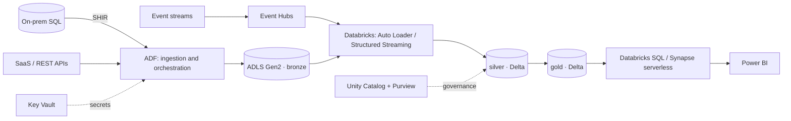
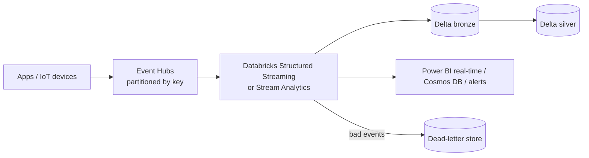

# Azure Architecture & Scenarios — Interview Question Bank

> Format: Question · Answer · Follow-ups · Difficulty

---

### Q1: Sketch a complete Azure data project that uses ADF, ADLS Gen2, Databricks and a BI serving layer.

**Answer:**

- **Ingestion:** ADF metadata-driven copies (Self-hosted IR for on-prem) and Event Hubs for streams, landing raw data in **bronze**.
- **Processing:** Databricks jobs (job clusters) build **silver** (clean, deduplicated, CDC applied) and **gold** (star schemas, aggregates) as Delta tables.
- **Serving:** Databricks SQL warehouses or Synapse serverless for SQL; Power BI semantic models.
- **Governance and security:** Unity Catalog (and Purview), Entra ID groups, private endpoints, Key Vault.
- **Operations:** ADF and Databricks monitoring to Log Analytics with alerts; CI/CD (ADF ARM, Databricks Asset Bundles) and IaC; data quality checks between layers; cost tags and budgets.

**Follow-ups:**
- Where would you put data quality checks in this design?
- What would change for near-real-time reporting?

**Difficulty:** Medium

---

### Q2: How would you process about 100 GB of new data every day on Azure?

**Answer:**
100 GB a day is moderate, so the design should be **incremental and simple**:
- **Ingest** with ADF copies or Auto Loader into ADLS bronze (Parquet or Delta), in parallel by file or table.
- **Transform** with a Databricks **job cluster** (e.g. 4–8 workers with autoscaling, Photon) on only the new data: incremental `MERGE` into silver, then aggregates into gold. That's typically tens of minutes.
- **Layout:** partition or liquid-cluster by date and key columns; file sizes of about 128 MB–1 GB; `OPTIMIZE` regularly.
- **Orchestrate** with ADF or Databricks Workflows: dependencies, retries, alerts, SLA monitoring.
- **Scale and cost:** autoscaling, spot workers, and a right-sized cluster based on Spark UI metrics (spill, idle cores).

State the assumptions (batch vs streaming, deadline, transformation complexity), because they change the sizing more than the 100 GB does.

**Follow-ups:**
- What would you change if the deadline were 15 minutes after files arrive?
- How do you size the cluster from a test run?

**Difficulty:** Medium

---

### Q3: How do you avoid creating duplicates when loading data incrementally?

**Answer:**
Defend at every step:
1. **Extract windows precisely:** use a watermark range (`> last AND <= current max`) captured **before** extracting, and advance the watermark only after a successful load. No overlap, no gap.
2. **Deduplicate the batch** on the business key (keep the latest version by `updated_at` or sequence) before writing.
3. **Write idempotently:** `MERGE` on the business key (update or insert), or overwrite only the affected partition. Never blind-append incremental data.
4. **Handle resent files:** Auto Loader or a file audit table skips files already processed; or hash files and records.
5. **Verify:** uniqueness checks on the key after loading (e.g. `GROUP BY key HAVING COUNT(*) > 1` returns nothing), with an alert if it fails.

**Follow-ups:**
- Why should the watermark be captured before the extract runs?
- How do you make a `MERGE` safe when the source batch has two versions of the same key?

**Difficulty:** Medium

---

### Q4: How would you handle a corrupted file arriving in your pipeline?

**Answer:**
- **Detect early:** validate on arrival: file size not zero, expected extension and encoding, header and schema, row counts versus the control or trigger file, checksums if the source provides them.
- **Don't fail everything:** move the file to a **quarantine** folder, log the reason in an audit table, and continue processing the other files.
- **Partial corruption:** for row-level errors, use permissive parsing (`badRecordsPath`, `_corrupt_record`, ADF fault tolerance logging incompatible rows), load the good rows and keep the bad ones for review, as long as the business accepts partial data. Otherwise reject the whole file.
- **Alert and ask:** notify the source team with details, and request a resend.
- **Reprocess idempotently:** when the corrected file arrives, the load (`MERGE` or partition overwrite) replaces the previous partial data without duplicates.

**Follow-ups:**
- When would you reject the whole file instead of loading the good rows?
- How do you stop a corrupted file from being retried forever?

**Difficulty:** Medium

---

### Q5: What would you put in place to secure an Azure data lake?

**Answer:**
- **Identity and access:** Entra ID groups; **RBAC** for broad roles and **POSIX ACLs** for folder-level access in ADLS Gen2; Unity Catalog grants for lakehouse tables; managed identities for services; no account keys or SAS in code (disable shared key access where possible).
- **Network:** disable public access, use **private endpoints** and VNet integration for Databricks, ADF managed VNet and Synapse; firewall rules.
- **Data protection:** encryption at rest (customer-managed keys if required), TLS 1.2+, soft delete and versioning, **immutable storage** for audit data.
- **Sensitive data:** classify with Purview, separate zones or containers for PII, masking or tokenization, and row and column controls in the serving layers.
- **Monitoring and governance:** storage diagnostic logs, Microsoft Defender for Storage (threat detection), Azure Policy guardrails, regular access reviews.

**Follow-ups:**
- How do RBAC and ACLs interact in ADLS Gen2?
- Why disable shared key authorization?

**Difficulty:** Medium

---

### Q6: In a multi-table pipeline, how do you handle one table failing while the others succeed?

**Answer:**
- **Isolate failures:** process each table as its own unit (child pipeline per ForEach item, or a separate Databricks task). Set the ForEach to continue on failure, and capture each item's result instead of failing the whole run immediately.
- **Record status per table** in an audit or control table (success, failed, error message, rows, watermark), and advance watermarks **only for tables that succeeded**.
- **Decide what downstream may run:** independent tables proceed; dependent gold models wait or run with a "stale data" flag, depending on business rules.
- **Retry only the failures:** a rerun mode reads the failed rows from the control table.
- **Alert with specifics:** which table failed and why, with one aggregated notification.

At the end, mark the overall run "partially failed" so monitoring doesn't treat it as success.

**Follow-ups:**
- How would you stop a gold model from running on partially refreshed silver tables?
- How do you design reruns for only the failed tables?

**Difficulty:** Medium

---

### Q7: How would you design a real-time data pipeline on Azure?

**Answer:**

- **Ingest:** Event Hubs (or IoT Hub), with partition keys for per-entity ordering and Capture for raw archives.
- **Process:** Databricks Structured Streaming (complex logic, Delta, exactly-once with checkpoints) or Stream Analytics (SQL, simple windows). Use event-time windows and watermarks for late data, and deduplicate by event ID.
- **Serve:** Delta tables for analytics; a low-latency store (Cosmos DB, Azure SQL) or Power BI streaming for dashboards; Functions or Logic Apps for alerts.
- **Reliability:** checkpoints, dead-letter handling, idempotent sinks, scaling partitions and throughput units, and monitoring of lag (Event Hubs incoming vs outgoing, stream processing time).

Confirm the real latency requirement first: seconds, minutes, or "near real time" that micro-batches every few minutes can meet more cheaply.

**Follow-ups:**
- How do you handle events that arrive an hour late?
- When is a 5-minute micro-batch good enough?

**Difficulty:** Hard

---

### Q8: How does a data engineer's job differ from a cloud engineer's?

**Answer:**
- **Data engineering** focuses on **data**: building pipelines that ingest, transform, model and serve data reliably (ETL/ELT, SQL, Spark, data modeling, data quality, orchestration, warehouses and lakehouses). Success is trustworthy, timely data for analytics and ML.
- **Cloud engineering** focuses on **infrastructure and platforms**: networking, compute, identity, security, IaC, CI/CD, reliability and cost of cloud environments. Success is a secure, scalable, automated platform.

They overlap more and more: data engineers use IaC, CI/CD and cloud services daily, and platform or cloud engineers often build the data platform foundation (workspaces, networking, policies) that data engineers build on.

**Follow-ups:**
- Which cloud engineering skills help a data engineer most?
- Who should own the data platform's infrastructure code?

**Difficulty:** Easy

---

### Q9: What is Azure Logic Apps, and where does it fit in a data platform?

**Answer:**
Logic Apps is a **low-code workflow and integration** service: workflows are triggered by events or schedules and chain actions across **hundreds of connectors** (Office 365, Teams, SharePoint, Salesforce, SAP, HTTP, Service Bus, Blob).

In data platforms it's typically used for **glue tasks**:
- Sending formatted **email or Teams notifications** on ADF failures (called from a Web activity).
- Pulling files from email attachments or SharePoint into ADLS.
- Simple approval flows, or calling SaaS APIs that ADF lacks connectors for.

It isn't a data processing engine, so keep heavy data movement in ADF or Databricks. Standard (single-tenant) Logic Apps add VNet integration and better performance than Consumption.

**Follow-ups:**
- When would you choose Logic Apps over an Azure Function?
- How would you secure the HTTP trigger ADF calls?

**Difficulty:** Easy

---

### Q10: What does Azure API Management provide?

**Answer:**
Azure API Management (APIM) is a **gateway and management layer for APIs**:
- A single, secure front door for backend APIs (Functions, App Service, AKS, external services).
- **Policies:** authentication (OAuth, subscription keys, certificates), rate limiting and quotas, caching, request and response transformation, IP filtering.
- A **developer portal** for documentation and onboarding, versioning and revisions, analytics on usage.

In data platforms it's used to **expose data products as APIs** (e.g. an API over a curated SQL or Cosmos DB table) with security and throttling, or to govern calls to external APIs used by ingestion pipelines.

**Follow-ups:**
- How would you rate-limit consumers of a data API?
- Why put APIM in front of an Azure Function?

**Difficulty:** Easy

---

### Q11: What are Microsoft Fabric and OneLake?

**Answer:**
**Microsoft Fabric** is an all-in-one, **SaaS analytics platform** that brings data integration (Data Factory), data engineering (Spark), data warehousing, real-time intelligence (KQL), data science and **Power BI** into one product with a single capacity-based billing model and shared governance.

**OneLake** is Fabric's **single, organization-wide data lake** (built on ADLS Gen2), "OneDrive for data":
- Every Fabric workspace stores its lakehouse and warehouse data in OneLake, in open **Delta Parquet** format.
- **Shortcuts** reference data in ADLS, S3, Google Cloud Storage or other workspaces without copying.
- Every engine (Spark, SQL, Power BI Direct Lake, KQL) reads the same copy.

Fabric suits organizations that want a unified, managed Microsoft analytics stack; Databricks or Synapse may still be chosen for more control or multi-cloud needs.

**Follow-ups:**
- What are OneLake shortcuts, and why do they matter?
- What is Direct Lake mode in Power BI?

**Difficulty:** Easy

---

### Q12: What does Azure Migrate do?

**Answer:**
Azure Migrate is a central hub for **discovering, assessing and migrating** on-premises workloads to Azure:
- **Discovery and assessment:** an appliance discovers servers, databases and web apps, maps dependencies, and recommends Azure sizes and costs.
- **Migration tools:** server migration (VMware, Hyper-V, physical), database assessment and migration (with **Azure Database Migration Service** for SQL Server and others), web app migration, and Data Box for offline transfer.
- Progress tracking across migration projects.

In data migrations it's typically used early on, to inventory database servers and estimate target sizes, before moving data with DMS, ADF or Data Box.

**Follow-ups:**
- How does dependency mapping help plan migration waves?
- When would you use Azure Database Migration Service?

**Difficulty:** Easy

---

### Q13: What is Azure Automation used for?

**Answer:**
Azure Automation is a service for **process automation and configuration management**:
- **Runbooks** (PowerShell or Python) run on a schedule, by webhook or on alerts, in Azure or on hybrid workers on-premises.
- Update management and configuration (State Configuration / DSC; many of these features are moving to Azure Arc and Update Manager).

Data platform uses: **start and stop** resources on a schedule (pause a Synapse dedicated pool at night, scale a database before the nightly load), cleanup jobs, and automated remediation triggered by alerts. Alternatives today include Azure Functions, Logic Apps, and pipeline activities that call the REST APIs.

**Follow-ups:**
- How would you pause a Synapse dedicated pool outside business hours?
- When would you pick Functions instead of Automation runbooks?

**Difficulty:** Easy
