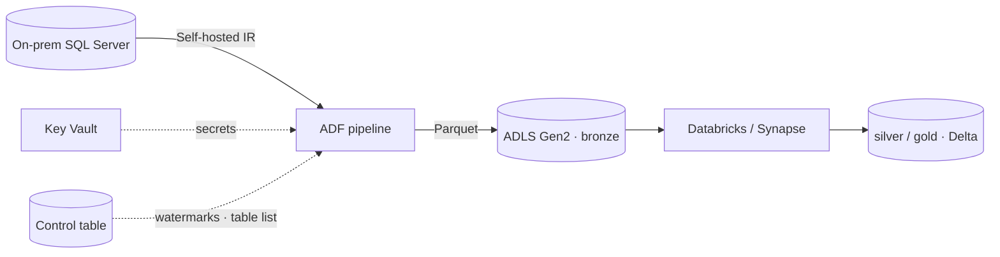
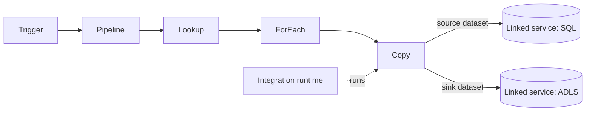

# Azure Data Factory — Interview Question Bank

> Format: Question · Answer · Follow-ups · Difficulty

---

### Q1: Design an Azure pipeline that extracts data from an on-premises SQL Server into ADLS Gen2.

**Answer:**

1. **Connectivity:** install a **Self-hosted IR** (two nodes for HA) on a machine that can reach SQL Server; the linked service gets its credentials from **Key Vault**.
2. **Metadata-driven ingestion:** a control table lists source tables, load type (full or incremental), watermark column and target path; Lookup → ForEach → parameterized Copy.
3. **Incremental loads:** watermarks (`modified_date > last value`) or SQL CDC; land data as Parquet partitioned by load date in **bronze**.
4. **Transform:** Databricks or Synapse builds silver and gold Delta tables.
5. **Operations:** logging to an audit table, retries, alerts through Azure Monitor, CI/CD for the factory, and private endpoints for ADLS.

**Follow-ups:**
- How would you size and secure the Self-hosted IR?
- How do you handle tables that have no watermark column?

**Difficulty:** Medium

---

### Q2: Millions of rows change every day. How would you load only the changes with ADF?

**Answer:**
The **watermark pattern**:
1. A **control table** stores the last watermark per source table.
2. A **Lookup** reads the old watermark; another Lookup reads the current max (`SELECT MAX(modified_date) FROM src`).
3. A **Copy** extracts `WHERE modified_date > @{old} AND modified_date <= @{new}` into a staging or bronze folder (Parquet).
4. A **Stored Procedure** or Databricks step `MERGE`s staging into the target, then **updates the watermark only after success**.

For millions of rows: partition the copy (dynamic range or physical partitions, parallel copies, enough DIUs), push the filter to the source (an index on the watermark column), and write Parquet. Prefer **native CDC** (SQL CDC, the ADF CDC resource) when deletes must be captured. Use a **tumbling window trigger** to pass window boundaries and backfill safely.

**Follow-ups:**
- Why read the new max watermark before copying instead of after?
- What does the watermark pattern miss?

**Difficulty:** Medium

---

### Q3: What's the best way to move a very large on-premises database into ADLS through a Self-hosted IR?

**Answer:**
- **Infrastructure:** install the Self-hosted IR on a well-sized VM close to the source (CPU, memory, network), with **multiple nodes** for throughput and HA; open outbound 443 only.
- **Parallelism:** use the Copy activity's **partition options** (physical partitions, or a dynamic range on a numeric or date column) so several queries run in parallel; tune `parallelCopies`.
- **Format:** write compressed **Parquet** (or staged copies) to reduce network volume; avoid row-by-row sinks.
- **Chunk the history:** load by year or month in separate runs (driven by a control table), so failures only redo one chunk.
- **Network:** ExpressRoute or VPN for very large volumes, or **Azure Data Box** for one-time bulk loads of many TB.
- **After the initial load:** switch to incremental (watermark or CDC) and validate counts per chunk.

**Follow-ups:**
- How do the partition options of a Copy activity work?
- When would you use Data Box instead of the network?

**Difficulty:** Medium

---

### Q4: ADF vs Azure Databricks vs Synapse Analytics: what is each for, and when would you use which?

**Answer:**
| | Azure Data Factory | Azure Databricks | Azure Synapse Analytics |
|---|---|---|---|
| Core role | **Orchestration and data movement** (ETL/ELT pipelines, 100+ connectors) | **Spark-based processing**: data engineering, streaming, ML, lakehouse on Delta | **Analytics workspace**: dedicated and serverless SQL pools, Spark pools, pipelines |
| Strength | Low-code copy and scheduling, hybrid connectivity (Self-hosted IR) | Large-scale transformations, Delta Lake, Unity Catalog, notebooks | SQL data warehousing (MPP), querying the lake with SQL |
| Typical use | Ingest from sources, trigger downstream jobs | Bronze → silver → gold transformations | Serving a warehouse to BI with T-SQL |

A common combination: **ADF** ingests and orchestrates, **Databricks** transforms the lakehouse, and **Synapse SQL** (or Databricks SQL, Power BI) serves analytics. Today Microsoft Fabric is also an option that unifies these.

**Follow-ups:**
- When would you skip Synapse and serve directly from Databricks SQL?
- Why not do heavy transformations in ADF Data Flows?

**Difficulty:** Medium

---

### Q5: How would you speed up a slow ADF pipeline?

**Answer:**
1. **Find the slow activity** in Monitor: queue time vs execution time, and the Copy activity's **throughput and duration breakdown** (the bottleneck can be source read, transfer or sink write).
2. **Copy tuning:** more **DIUs** (data integration units) and `parallelCopies`, partitioned source reads, staged copy (through Blob) for some sinks, Parquet instead of CSV, bigger batch sizes for database sinks.
3. **Source and sink:** indexes on filter columns, avoid `SELECT *`, check database DTU/vCore throttling, and use bulk insert / PolyBase / `COPY INTO` for Synapse.
4. **Pipeline design:** run independent activities in parallel (ForEach with a batch count), reduce sequential Lookups, reuse data flow clusters (TTL).
5. **Integration runtime:** Self-hosted IR CPU or memory saturation (scale out nodes); the region of the Azure IR close to the data.
6. **Process less:** incremental loads instead of full reloads.

**Follow-ups:**
- How do you read the Copy activity's duration breakdown?
- When does increasing DIUs stop helping?

**Difficulty:** Medium

---

### Q6: How do you use parameters and dynamic content to make ADF pipelines reusable?

**Answer:**
- **Parameterize everything that varies:** pipeline parameters (table name, schema, date window), **dataset parameters** (file path, table), **linked service parameters** (server and database names, so one linked service serves many databases), and **global parameters** for environment-wide values.
- **Dynamic content expressions** build values at runtime:
  ```text
  @concat('bronze/', pipeline().parameters.tableName, '/', formatDateTime(utcNow(), 'yyyy/MM/dd'), '/')
  @{pipeline().parameters.schema}.@{pipeline().parameters.tableName}
  ```
- **Drive it from metadata:** a control table lists the sources, Lookup reads them, ForEach passes `@item().tableName` into a parameterized child pipeline.
- In CI/CD, override environment values (URLs, Key Vault names) through ARM template parameters or global parameters.

**Follow-ups:**
- How do you parameterize a linked service for many databases?
- What's the difference between `@{...}` string interpolation and a plain `@` expression?

**Difficulty:** Medium

---

### Q7: How do you monitor ADF pipeline runs and send an email when a pipeline fails?

**Answer:**
- **Built-in monitoring:** the Monitor tab (runs, activity details, rerun), and **alerts & metrics** in ADF (e.g. *Failed pipeline runs > 0*) wired to an **action group** that emails, sends SMS or calls a webhook.
- **Long-term analysis:** diagnostic settings send pipeline, activity and trigger runs to **Log Analytics**; query them with KQL and build workbooks or dashboards.
- **Custom notifications** with context (pipeline name, run ID, error message): on the failure path of an activity, call a **Web activity** → **Logic App** (or Power Automate / Teams webhook) that sends a formatted email.

```text
Web activity body:
{"pipeline":"@{pipeline().Pipeline}","runId":"@{pipeline().RunId}",
 "error":"@{activity('Copy_orders').error.message}"}
```

Also alert on **long durations** (SLA risk), not only on failures.

**Follow-ups:**
- How do you make the failure path fire only once per pipeline, not once per activity?
- What KQL query would list failures in the last 24 hours?

**Difficulty:** Easy

---

### Q8: How would you build one ADF pipeline that handles hundreds of source tables from configuration?

**Answer:**
**Control table** (one row per source object):

| source_schema | source_table | load_type | watermark_column | last_watermark | target_path | enabled | priority |
|---|---|---|---|---|---|---|---|

**Pipeline design:**
1. A **Lookup** reads the enabled rows (optionally by group or priority).
2. A **ForEach** (parallel, with a batch count to protect the source) calls a **child pipeline** with the row's values as parameters.
3. The child pipeline: Switch on `load_type` → full copy or incremental copy (watermark query) → write Parquet to the bronze path → update the watermark and write an **audit log** row (rows copied, duration, status).
4. **Error isolation:** one table's failure doesn't stop the others; failures are logged and retried individually.

Adding a table is then a single row insert, with no new pipelines. For 1,000+ tables, split the control table into groups or waves, and schedule them to respect source capacity.

**Follow-ups:**
- How do you stop one failed table from failing the whole ForEach?
- How would you rerun only the tables that failed?

**Difficulty:** Medium

---

### Q9: What's the difference between Azure Data Factory and Synapse pipelines?

**Answer:**
Synapse pipelines are **built on the same engine** as ADF: same activities, datasets, linked services, triggers and data flows. The differences:
- **Synapse pipelines live inside a Synapse workspace,** next to SQL pools, Spark pools and notebooks, so orchestrating Synapse-native work is convenient.
- **ADF is standalone** and is the usual choice for integration across many systems.
- Some features differ slightly: e.g. the Azure-SSIS integration runtime and some newer connectors or features arrive in ADF first, and Synapse has its own Git and CI/CD workflow for the whole workspace.
- Fabric Data Factory is the newer, SaaS-based successor in Microsoft Fabric.

Choose Synapse pipelines when the platform is Synapse-centric; ADF otherwise.

**Follow-ups:**
- Can you move pipelines between ADF and Synapse?
- Where does Fabric Data Factory fit in?

**Difficulty:** Easy

---

### Q10: What are the building blocks of Azure Data Factory, and how do they fit together?

**Answer:**
- **Pipeline:** a logical group of activities that together perform a task (e.g. ingest and transform a table).
- **Activities:** the steps: data movement (Copy), transformation (Data Flow, Databricks, stored procedure), and control flow (ForEach, If, Lookup, Execute Pipeline).
- **Datasets:** named references to data inside a store (a table, a folder, a file pattern).
- **Linked services:** connection definitions to stores and compute (like connection strings), ideally with secrets in Key Vault.
- **Integration runtime:** the compute that runs activities: Azure IR, Self-hosted IR (private networks), Azure-SSIS IR.
- **Triggers:** start pipelines (schedule, tumbling window, storage or custom events).
- **Parameters, variables and expressions** make everything dynamic.



**Follow-ups:**
- Why are linked services and datasets separate objects?
- Which integration runtime runs a Mapping Data Flow?

**Difficulty:** Easy

---

### Q11: What's the difference between a parameter and a variable in ADF?

**Answer:**
| | Parameter | Variable |
|---|---|---|
| Set | When the pipeline (or dataset or linked service) is **invoked**, by a trigger, a parent pipeline or a debug run | **During** the run, with Set Variable / Append Variable |
| Changeable during the run | No (read-only) | Yes |
| Scope | Pipeline, dataset, linked service, data flow; **global parameters** at factory level | Pipeline only |
| Syntax | `@pipeline().parameters.tableName` | `@variables('fileCount')` |

Use **parameters** to make one pipeline reusable (table name, date, environment) and **variables** for values computed inside the run (counters, flags, file lists). Variables inside a parallel ForEach aren't thread-safe, so run it sequentially or avoid shared variables.

**Follow-ups:**
- Why can setting a variable inside a parallel ForEach give wrong results?
- When would you use a global parameter?

**Difficulty:** Easy

---

### Q12: Compare ADF's schedule, tumbling window and event-based triggers.

**Answer:**
| Trigger | Fires | Key features | Use for |
|---|---|---|---|
| **Schedule** | At wall-clock times (cron-like) | Many pipelines per trigger; no state; no backfill | Simple daily or hourly jobs |
| **Tumbling window** | For fixed, contiguous, non-overlapping time windows | One pipeline per trigger; passes `windowStart` / `windowEnd`; **backfill** of past windows, retries, dependencies on other windows, max concurrency | Incremental loads that must process every window exactly once |
| **Storage event** | When a blob is created or deleted (Event Grid) | Filters on path and file type; passes folder and file name | Process files as they arrive |
| **Custom event** | On custom Event Grid topics | Event payload available | Integration with other systems |

Pick tumbling window when correctness per time window matters (late reruns, gap-free processing); storage events for low-latency file pipelines.

**Follow-ups:**
- How would you backfill the last 30 days with a tumbling window trigger?
- What happens when a storage event fires twice for the same file?

**Difficulty:** Medium

---

### Q13: What's the difference between Debug and Trigger Now in ADF?

**Answer:**
- **Debug** runs the pipeline **from the current canvas, including unsaved and unpublished changes**, in the authoring environment. Output appears in the Output tab. Use it while developing and testing; debug runs can use a data flow debug session.
- **Trigger Now** runs the **last published version** of the pipeline, as a real triggered run that shows up in the Monitor tab.

So "Debug works but Trigger Now fails" usually means the latest changes weren't published, or the environment differs (parameters, linked services).

**Follow-ups:**
- Why might a pipeline behave differently in Debug and when triggered?
- Do debug runs count toward cost?

**Difficulty:** Easy

---

### Q14: In ADF, what's the difference between saving and publishing?

**Answer:**
- **Save** (or commit, in Git mode): stores your changes in your **Git branch** (or, without Git, in the authoring area). Nothing changes in the live service; triggers keep running the old version.
- **Publish:** pushes your changes into the running (**live**) factory, and in Git mode writes ARM templates to the `adf_publish` branch. Only after this do triggers and Trigger Now pick up the new version.

In Git mode you can only publish from the collaboration branch (usually `main`), so the normal flow is: feature branch → pull request → merge to main → publish, or better, automated CI/CD deployment to test and prod.

**Follow-ups:**
- What's stored in the `adf_publish` branch?
- Why do teams replace manual publishing with automated ARM template builds?

**Difficulty:** Easy

---

### Q15: Copy activity vs Mapping Data Flow: when do you use which?

**Answer:**
| | Copy activity | Mapping Data Flow |
|---|---|---|
| Purpose | Move data, with light changes (column mapping, format conversion) | Visual transformations: joins, aggregates, derived columns, SCD, pivots |
| Engine | ADF integration runtime | A managed **Spark** cluster spun up by ADF |
| Cost and startup | Cheap, starts in seconds | Cluster startup (minutes unless TTL is set) plus vCore-hours |
| Scale | Very high throughput (DIUs, parallel copies) | Scales with cluster size |

Use **Copy** to land data (ELT: copy raw, transform in the warehouse or Databricks). Use **Data Flows** for no-code transformations when you don't have Databricks or Spark skills. Use a **debug session** to test data flows interactively, and a TTL to reuse warm clusters.

**Follow-ups:**
- Why do many teams avoid Data Flows when they already have Databricks?
- What does the TTL setting do?

**Difficulty:** Medium

---

### Q16: How do you load incrementally when the source table has no modified-date column?

**Answer:**
Options, from best to last resort:
1. **Database CDC or change tracking:** SQL Server CDC or Change Tracking, Oracle log mining, MySQL binlog (Debezium). It captures inserts, updates and deletes without any timestamp column.
2. **Monotonic key:** an ever-increasing `id` or `rowversion` / timestamp column (SQL Server `rowversion` changes on every update) as the watermark.
3. **Hash comparison:** extract the key plus a **hash of the row's columns**, compare with the hashes stored from the last load, and load only new or changed keys (detects deletes too if you compare key sets).
4. **Ask for a column or trigger:** add `last_modified` via a trigger or default in the source, if the owners agree.
5. **Full load plus diff** (small tables): reload fully and `MERGE`, letting the merge detect changes.

Whatever you choose, apply changes with an idempotent `MERGE` and reconcile counts.

**Follow-ups:**
- How does SQL Server `rowversion` differ from a timestamp?
- How would you detect hard deletes with the hash approach?

**Difficulty:** Hard
