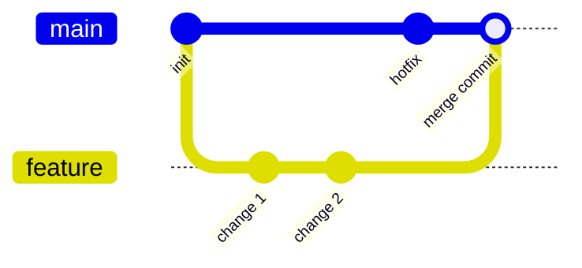

# Git, Terraform & CI/CD — Interview Question Bank

*(Related questions on CI/CD for Airflow, `git merge` vs `git rebase`, Docker and Terraform `plan` vs `apply` are in [`gcp/cloud-bigdata-ecosystem-interview-qa.md`](../gcp/cloud-bigdata-ecosystem-interview-qa.md).)*

> Format: Question · Answer · Follow-ups · Difficulty

---

### Q1: What is Git, and how is it different from GitHub?

**Answer:**
- **Git** is a **distributed version control system**. It tracks changes to files, keeps the full history in every clone, and supports branching and merging. Running `git init` creates a repository (a hidden `.git` folder holding the history).
- **GitHub** is a **hosting platform** for Git repositories. It adds collaboration features: pull requests and code review, issues, branch protection, Actions (CI/CD) and integrations. GitLab and Bitbucket are alternatives.

In short: Git is the tool, GitHub is a service built around it.

**Follow-ups:**
- What does "distributed" mean in practice?
- What does a repository contain besides your files?

**Difficulty:** Easy

---

### Q2: What's the difference between `git commit`, `git push`, `git fetch` and `git pull`?

**Answer:**
| Command | What it does |
|---|---|
| `git commit` | Records a snapshot of staged changes in your **local** repository |
| `git push` | Sends your local commits to the **remote** (e.g. GitHub) |
| `git fetch` | Downloads remote commits **without** changing your working branch |
| `git pull` | `fetch` + merge (or rebase) the remote branch into your current branch |

Commits are local and can be made offline; nothing is shared until you push.

**Follow-ups:**
- When would you prefer `git fetch` over `git pull`?
- How do you undo a commit that you haven't pushed yet?

**Difficulty:** Easy

---

### Q3: What are branches, and how do you create and switch between them?

**Answer:**
A branch is a lightweight, movable **pointer to a commit**. Branches isolate work on features, fixes or experiments from `main`, so several people can work in parallel.

```bash
git branch feature/orders-dag          # create
git switch feature/orders-dag          # switch (older form: git checkout feature/orders-dag)
git switch -c feature/orders-dag       # create and switch in one step (git checkout -b ...)
git branch -d feature/orders-dag       # delete after merging
```

Common conventions: `feature/<topic>` and `fix/<topic>` branches off `main`, merged through pull requests.

**Follow-ups:**
- What's the difference between `git switch` and `git checkout`?
- What is a detached HEAD?

**Difficulty:** Easy

---

### Q4: How does `git merge` work, and how do you resolve a merge conflict?

**Answer:**
`git merge` integrates another branch's changes into the current branch. If the branches have diverged, Git creates a **merge commit** with two parents; if the current branch has no new commits, it simply moves the pointer forward (**fast-forward**).



A **conflict** happens when both branches changed the same lines. Git marks them (`<<<<<<<`, `=======`, `>>>>>>>`); you edit the file to the correct result, then `git add` it and `git commit` (or `git merge --continue`). Abort with `git merge --abort`.

**Follow-ups:**
- What's the difference between a merge commit, a squash merge and a rebase?
- How do you reduce merge conflicts on a busy repository?

**Difficulty:** Easy

---

### Q5: What is a pull request, and what does a good review process look like?

**Answer:**
A pull request (PR) proposes merging a branch into another (usually `main`). It's where changes are **reviewed, discussed and tested** before merging.

A good process:
- Small, focused PRs with a clear description
- **CI checks** run automatically: tests, linting, `terraform plan`, `dbt build`
- **Branch protection:** required reviews (e.g. from code owners), passing checks, no direct pushes to `main`
- Reviewers check correctness, readability, data impact and security (no secrets)
- Merge with squash or merge commit, then delete the branch

**Follow-ups:**
- What would you check when reviewing a pull request that changes a production DAG?
- What does a CODEOWNERS file do?

**Difficulty:** Easy

---

### Q6: What is Terraform state, and how do you manage it safely?

**Answer:**
The **state file** maps your Terraform configuration to the real resources it created (IDs and attributes). Terraform compares state, configuration and reality to work out what to change.

Managing it safely:
- Use a **remote backend**, e.g. a versioned **Cloud Storage bucket** (`backend "gcs"`), so the team shares one state. The GCS backend also provides **state locking**, so two `apply`s can't run at once.
- **Never commit state to Git.** It can contain secrets.
- Keep **separate state per environment** (different prefixes or buckets for dev, qa, prod).
- Restrict access to the state bucket and enable object versioning for recovery.

```hcl
terraform {
  backend "gcs" {
    bucket = "my-tf-state-bucket"
    prefix = "data-platform/dev"
  }
}
```

**Follow-ups:**
- What happens if someone changes a resource manually in the console (drift)?
- How do you bring an existing resource under Terraform (`terraform import`)?

**Difficulty:** Medium

---

### Q7: What are Terraform modules, and how do you organize them?

**Answer:**
A module is a reusable set of Terraform files with **inputs (variables)** and **outputs**. Every configuration is the root module; you call child modules for repeated patterns, e.g. a "BigQuery dataset with standard IAM and labels" module used for every team.

```hcl
module "sales_dataset" {
  source     = "./modules/bq_dataset"
  dataset_id = "sales"
  location   = var.region
  readers    = ["group:sales-analysts@example.com"]
}
```

Good practices: keep modules small and focused, expose only the inputs that are needed, **pin versions** for modules from a registry or Git (`?ref=v1.2.0`), and document inputs and outputs.

**Follow-ups:**
- When does a module become too generic to be useful?
- How do you pass outputs from one module into another?

**Difficulty:** Medium

---

### Q8: How do you declare and set variables in Terraform, and which value wins?

**Answer:**
Declare variables with a type, description and optional default:

```hcl
variable "region" {
  type        = string
  description = "GCP region for resources"
  default     = "us-central1"
}
```

Then use them as `var.region`. Values can come from several places. In order of precedence, **later ones win**:
1. The `default` in the declaration
2. Environment variables `TF_VAR_region`
3. `terraform.tfvars` / `terraform.tfvars.json`
4. `*.auto.tfvars` files (alphabetical order)
5. `-var` and `-var-file` on the command line (in the order given)

Mark secrets with `sensitive = true`, and add `validation` blocks to catch bad input early.

**Follow-ups:**
- How would you supply different values for dev and prod?
- Does `sensitive = true` keep a value out of the state file?

**Difficulty:** Medium

---

### Q9: What are implicit and explicit dependencies in Terraform?

**Answer:**
- **Implicit:** when one resource references another's attribute, Terraform orders them automatically. For example, a subnet that uses `google_compute_network.vpc.id` is created after the VPC.
- **Explicit (`depends_on`):** used when there's a real dependency but **no attribute reference**. Typical cases: a VM that needs a firewall rule or an enabled API first, or a Composer environment that needs an IAM binding to exist before it can start.

```hcl
resource "google_compute_instance" "etl_vm" {
  # ...
  depends_on = [google_compute_firewall.allow_internal]
}
```

Prefer implicit references; use `depends_on` sparingly, because it makes plans more conservative.

**Follow-ups:**
- How do you visualize the dependency graph (`terraform graph`)?
- What problems can `depends_on` on a module cause?

**Difficulty:** Medium

---

### Q10: How do you structure Terraform for several environments (dev, qa, prod)?

**Answer:**
A common layout keeps one set of `.tf` files and gives each environment its own variable file and backend config:

```
infrastructure/terraform/
├── main.tf / bigquery.tf      # resources
├── variables.tf               # variable declarations
├── outputs.tf
├── data_sources.tf
├── dev.tfvars   qa.tfvars   prod.tfvars                     # per-environment values
└── dev_backend.conf   qa_backend.conf   prod_backend.conf   # state bucket and prefix per environment
.github/workflows/
└── terraform-plan.yaml        # CI: plan on pull request, apply after approval
```

```bash
terraform init  -backend-config=dev_backend.conf
terraform plan  -var-file=dev.tfvars
```

Alternatives are one directory per environment calling shared modules (clearer isolation), or Terraform workspaces (simpler, but easier to apply to the wrong environment). Whichever you choose, keep **separate state** and **separate service accounts** per environment.

**Follow-ups:**
- How do you promote the same change from dev to prod safely?
- Why are workspaces risky for prod and dev separation?

**Difficulty:** Medium

---

### Q11: What are common Terraform mistakes, and what are the best practices?

**Answer:**
| Mistake | Best practice |
|---|---|
| Local or committed state | Remote GCS backend with locking and versioning |
| Hard-coded project IDs, regions and names | Variables, `locals` and per-environment `.tfvars` |
| Running `apply` without reviewing a plan | `plan` in CI on every pull request, apply only after approval |
| Changing resources by hand in the console | Everything through code; detect drift with scheduled plans |
| Secrets in `.tf` files | Secret Manager, `sensitive` variables, CI secrets |
| Over-privileged Terraform service account | Least-privilege roles, Workload Identity Federation |
| Unpinned provider and module versions | `required_providers` with version constraints, lock file committed |

Also run `terraform fmt` and `terraform validate` in CI, and keep resources small and modular.

**Follow-ups:**
- How would you detect drift automatically?
- Why commit `.terraform.lock.hcl` but not the `.terraform/` folder?

**Difficulty:** Medium

---

### Q12: How would you run Terraform through GitHub Actions?

**Answer:**
- **On pull request:** `fmt -check`, `init`, `validate`, `plan`, and post the plan as a PR comment for review.
- **On merge to `main`** (or a manual approval through a protected environment): `apply` the reviewed change.
- **Authentication:** **Workload Identity Federation** (`google-github-actions/auth`), so no service-account keys are stored in GitHub.

```yaml
name: terraform
on:
  pull_request:
  push:
    branches: [main]
permissions:
  contents: read
  id-token: write          # needed for Workload Identity Federation
jobs:
  terraform:
    runs-on: ubuntu-latest
    environment: dev       # use a protected environment to require approval for prod
    steps:
      - uses: actions/checkout@v4
      - uses: google-github-actions/auth@v2
        with:
          workload_identity_provider: ${{ vars.WIF_PROVIDER }}
          service_account: ${{ vars.TF_SERVICE_ACCOUNT }}
      - uses: hashicorp/setup-terraform@v3
      - run: terraform init -backend-config=dev_backend.conf
      - run: terraform fmt -check && terraform validate
      - run: terraform plan -var-file=dev.tfvars -out=tfplan
      - if: github.ref == 'refs/heads/main' && github.event_name == 'push'
        run: terraform apply -auto-approve tfplan
```

**Follow-ups:**
- Why is applying a saved plan file safer than running `apply` again?
- How would you extend this pipeline to several environments with approvals?

**Difficulty:** Hard
