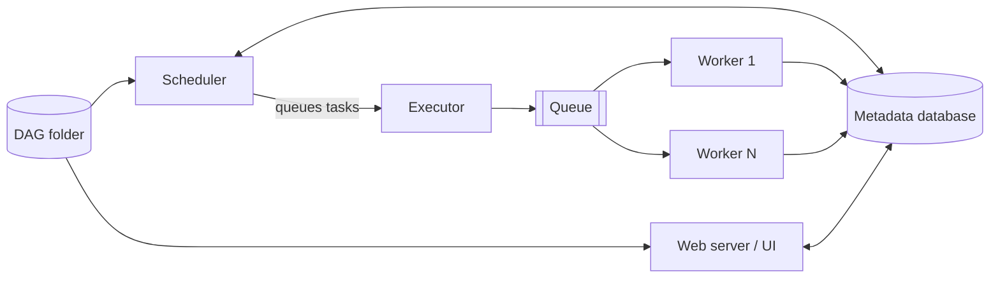

# Airflow / Cloud Composer — Interview Question Bank

> Format: Question · Answer · Follow-ups · Difficulty

---

### Q1: What is a DAG in Airflow?

**Answer:**
A **Directed Acyclic Graph** — the definition of a workflow as a set of tasks and the dependencies between them (edges point one direction, no cycles allowed). Written as Python code; Airflow's scheduler parses these files to figure out what to run and when.
```python
from airflow import DAG
from airflow.operators.python import PythonOperator
from datetime import datetime

with DAG("daily_etl", start_date=datetime(2024,1,1), schedule_interval="@daily", catchup=False) as dag:
    extract = PythonOperator(task_id="extract", python_callable=extract_fn)
    transform = PythonOperator(task_id="transform", python_callable=transform_fn)
    load = PythonOperator(task_id="load", python_callable=load_fn)

    extract >> transform >> load
```

**Follow-ups:**
- Why must a DAG be acyclic?
- What's the difference between a DAG and a DAG run?

**Difficulty:** Easy

---

### Q2: Operators vs Sensors vs Hooks — what's the difference?

**Answer:**
- **Operator**: defines a single unit of work (a task) — e.g. `PythonOperator`, `BashOperator`, `BigQueryInsertJobOperator`.
- **Sensor**: a special operator that waits/polls for a condition to become true before letting downstream tasks run (e.g. `GCSObjectExistenceSensor` waits for a file to land).
- **Hook**: a reusable interface for connecting to an external system (DB, GCS, BigQuery, API) — operators use hooks internally to do the actual work; you can also use hooks directly inside a `PythonOperator` for custom logic.

**Follow-ups:**
- Give an example of a hook used inside a custom operator.
- When would you write a custom operator?

**Difficulty:** Easy

---

### Q3: What are XComs, and what are their limitations?

**Answer:**
XCom ("cross-communication") lets tasks push and pull small pieces of data between each other via the metadata database.
```python
def extract(**context):
    context["ti"].xcom_push(key="row_count", value=1000)

def transform(**context):
    n = context["ti"].xcom_pull(task_ids="extract", key="row_count")
```
With the TaskFlow API (`@task`), return values are automatically XCom'd — no manual push/pull needed. **Limitation**: XComs are meant for small metadata (IDs, counts, file paths), not for passing large datasets between tasks — the actual data should move through external storage (GCS, BigQuery), with the task just passing a reference/pointer.

**Follow-ups:**
- Where are XComs stored, and why shouldn't you pass large data through them?
- How does the TaskFlow API use XComs implicitly?

**Difficulty:** Medium

---

### Q4: Explain `schedule_interval`, `catchup`, and backfilling.

**Answer:**
- `schedule_interval` (or `schedule` in newer Airflow) defines how often the DAG should run (cron expression, preset like `@daily`, or `timedelta`).
- **`catchup=True`** (default) tells Airflow to automatically run all missed intervals between `start_date` and now when a DAG is first turned on or was paused — this can trigger a burst of runs. **`catchup=False`** only runs from the most recent scheduled interval onward.
- **Backfilling** is manually triggering runs for past intervals (`airflow dags backfill`), useful for reprocessing historical data after a bug fix, independent of the `catchup` setting.

**Follow-ups:**
- What happens if `catchup=True` on a DAG with a start date a year ago?
- How do you run a backfill from the CLI?

**Difficulty:** Medium

---

### Q5: What does "the DAG run's logical/execution date is the *start* of the interval, not when it actually runs" mean, and why does it confuse people?

**Answer:**
Airflow schedules are interval-based: a DAG with `schedule_interval="@daily"` and `execution_date=2024-01-01` represents the data *for* Jan 1, but Airflow actually kicks it off at the **end** of that interval — i.e., at midnight Jan 2 (after the full day's data exists). This trips people up because the run "labeled" Jan 1 doesn't fire until Jan 2. (Airflow 2.2+ also introduced the clearer `logical_date`/`data_interval_start`/`data_interval_end` naming to reduce this confusion.)

**Follow-ups:**
- What is `data_interval_start` versus `logical_date`?
- How would you query yesterday's partition using templates?

**Difficulty:** Medium

---

### Q6: What are trigger rules, and give an example use case.

**Answer:**
Trigger rules control when a task runs based on the state of its upstream tasks — the default is `all_success`. Others include `all_failed`, `one_success`, `all_done` (runs regardless of upstream success/failure), and `none_failed`.
```python
notify_failure = PythonOperator(
    task_id="notify_failure",
    python_callable=send_alert,
    trigger_rule="one_failed",   # run only if at least one upstream task failed
)
```
Common use case: a cleanup or alerting task that must run whether upstream tasks succeeded or failed (`trigger_rule="all_done"`).

**Follow-ups:**
- When would you use `all_done` or `one_failed`?
- How do you build a cleanup task that always runs?

**Difficulty:** Medium

---

### Q7: What executors does Airflow support, and which does Cloud Composer use?

**Answer:**
- **SequentialExecutor**: runs one task at a time, no parallelism — dev/testing only.
- **LocalExecutor**: parallel tasks on a single machine.
- **CeleryExecutor**: distributes tasks across a pool of worker machines via a message broker (Redis/RabbitMQ).
- **KubernetesExecutor**: launches each task in its own Kubernetes pod, scaling workers dynamically.
- **CeleryKubernetesExecutor**: hybrid — most tasks via Celery workers, specific tasks routed to their own pod.
Cloud Composer (both Composer 1 and Composer 2, which runs on GKE) uses **CeleryExecutor** or **KubernetesExecutor** depending on version/configuration; Composer 2 environments commonly default to CeleryExecutor with the option to route tasks to KubernetesExecutor via `KubernetesPodOperator`.

**Follow-ups:**
- What are the trade-offs between Celery and Kubernetes executors?
- Why isn't `SequentialExecutor` used in production?

**Difficulty:** Medium

---

### Q8: How is Cloud Composer's architecture different from a self-managed Airflow install?

**Answer:**
Composer is a managed Airflow service on GCP that runs on top of **GKE (Google Kubernetes Engine)**. Google manages the Airflow webserver, scheduler, and worker infrastructure, scaling, and upgrades. DAG files live in a **Cloud Storage bucket** (`gs://<bucket>/dags/`) that's automatically synced into the environment; logs go to Cloud Logging; metadata DB is a managed Cloud SQL instance. You mainly interact with it via the Airflow UI, `gcloud composer` CLI, and the GCS bucket for deploying DAGs — you don't manage the underlying servers/executors directly.

**Follow-ups:**
- Which GCP resources make up a Composer environment?
- How do Composer 2 and Composer 3 differ?

**Difficulty:** Medium

---

### Q9: How do Airflow Variables and Connections work, and how are they managed in Composer?

**Answer:**
- **Variables**: key-value config values (e.g., a bucket name, a threshold) accessible via `Variable.get("key")` — avoid hardcoding environment-specific values in DAG code.
- **Connections**: store credentials/connection info for external systems (DB, GCP, API) accessed via hooks/operators by a `conn_id`.
Both can be set via the Airflow UI, CLI, environment variables, or (recommended for production) backed by **Secret Manager** in Composer, so secrets aren't sitting in the Airflow metadata DB in plaintext.

**Follow-ups:**
- Why should you avoid reading Variables at the top level of a DAG file?
- How do you use Secret Manager as a secrets backend?

**Difficulty:** Easy

---

### Q10: How would you implement branching logic in a DAG?

**Answer:**
```python
from airflow.operators.python import BranchPythonOperator

def choose_branch(**context):
    if context["ti"].xcom_pull(task_ids="check_data") > 0:
        return "process_data"
    return "skip_processing"

branch = BranchPythonOperator(task_id="branch", python_callable=choose_branch)
branch >> [process_data, skip_processing]
```
`BranchPythonOperator` returns the `task_id` (or list of ids) that should run next; Airflow automatically skips the other downstream paths.

**Follow-ups:**
- What happens to the tasks on the branch that isn't chosen?
- Which trigger rule should the join task after a branch use?

**Difficulty:** Easy

---

### Q11: What's the difference between a sensor in `poke` mode vs `reschedule` mode?

**Answer:**
- **`poke`** (default): the sensor's worker slot stays occupied the entire time it's waiting, repeatedly checking on an interval — wasteful if the wait is long.
- **`reschedule`**: the sensor releases its worker slot between checks and reschedules itself, freeing up resources for other tasks while waiting — much better for sensors with long/unpredictable wait times (e.g., waiting hours for a file).
Even better for very long waits: **deferrable operators/sensors** (`deferrable=True`, using triggers), which don't occupy a worker slot at all while waiting — the check runs in a lightweight triggerer process.

**Follow-ups:**
- Why does `poke` mode waste worker slots?
- What are deferrable operators, and how do they improve on `reschedule`?

**Difficulty:** Medium

---

### Q12: How do you make a DAG dynamic (e.g., generate tasks based on a list of tables to load)?

**Answer:**
```python
tables = ["orders", "customers", "products"]

with DAG("dynamic_load", ...) as dag:
    for table in tables:
        PythonOperator(
            task_id=f"load_{table}",
            python_callable=load_table,
            op_kwargs={"table": table},
        )
```
For more complex, data-driven fan-out (unknown at DAG-parse time), Airflow 2.3+ supports **dynamic task mapping** (`.expand()`), which creates task instances at runtime based on upstream output.
```python
@task
def get_tables():
    return ["orders", "customers", "products"]

@task
def load(table):
    ...

load.expand(table=get_tables())
```

**Follow-ups:**
- What's dynamic task mapping (`.expand()`)?
- What are the risks of generating DAGs from an external config at parse time?

**Difficulty:** Medium

---

### Q13: What are TaskGroups and why use them?

**Answer:**
`TaskGroup` visually and logically groups related tasks in the Airflow UI graph view (collapsible), without adding an actual execution dependency layer the way a SubDAG does. Preferred over the now-deprecated SubDAGOperator, which had its own scheduler overhead/deadlock issues.
```python
from airflow.utils.task_group import TaskGroup

with TaskGroup("extract_group") as extract_group:
    extract_orders = PythonOperator(...)
    extract_customers = PythonOperator(...)
```

**Follow-ups:**
- How do TaskGroups differ from SubDAGs?
- Can you set dependencies on a whole TaskGroup?

**Difficulty:** Easy

---

### Q14: How do retries and SLAs work in Airflow?

**Answer:**
```python
default_args = {
    "retries": 3,
    "retry_delay": timedelta(minutes=5),
    "retry_exponential_backoff": True,
    "sla": timedelta(hours=2),
}
```
- **`retries`/`retry_delay`**: how many times and how often Airflow re-attempts a failed task automatically before marking it failed for good.
- **SLA**: not a retry mechanism — if a task hasn't *finished* within the SLA window (measured from the DAG run's start), Airflow fires an SLA-miss callback/alert, but the task keeps running; it's purely for monitoring/alerting on slowness.

**Follow-ups:**
- How do you add exponential backoff to retries?
- What happens when an SLA is missed?

**Difficulty:** Medium

---

### Q15: What are best practices for writing production-quality DAGs?

**Answer:**
- Keep DAG files lightweight — avoid heavy computation or network calls at the top level (outside task functions), since the scheduler re-parses every DAG file periodically.
- Make tasks **idempotent** (safe to re-run/retry without duplicating results) — e.g., overwrite/upsert a partition rather than blindly appending.
- Push actual data through GCS/BigQuery/etc., not through XCom.
- Use `catchup=False` unless you specifically need historical backfill behavior.
- Set sensible `retries`, alerting (`on_failure_callback`, SLAs), and timeouts.
- Parameterize environment-specific values via Airflow Variables/Connections, not hardcoded in DAG code.
- Version-control DAGs and use CI/CD to deploy to the Composer GCS bucket rather than editing directly.

**Follow-ups:**
- Why must tasks be idempotent?
- Why should heavy logic be kept out of top-level DAG code?

**Difficulty:** Medium

---

### Q16: How would you monitor and alert on DAG failures in Composer?

**Answer:**
- Airflow's own `on_failure_callback` / `on_success_callback` at the task or DAG level (e.g., posting to Slack, PagerDuty).
- Composer integrates with **Cloud Monitoring** and **Cloud Logging** — you can set up alerting policies on scheduler health, task failure counts, and DAG-level metrics.
- Email alerts via `email_on_failure=True` with an SMTP connection configured.
- For SLA misses, Airflow's built-in SLA-miss alert / callback.

**Follow-ups:**
- How would you send failures to Slack?
- Which Cloud Monitoring metrics would you alert on?

**Difficulty:** Medium

---

### Q17: What is a `KubernetesPodOperator`, and when would you reach for it in Composer?

**Answer:**
It launches a task as its own Kubernetes Pod (running any container image) inside the GKE cluster, rather than running Python code directly on an Airflow worker. Useful when:
- The task needs dependencies/libraries that conflict with Airflow's own environment.
- You want strong isolation and custom resource limits per task.
- The logic is already packaged as a container (e.g., a Spark job runner, a custom ML training script).

**Follow-ups:**
- How does it isolate dependencies compared with `PythonOperator`?
- What resource settings do you need to configure on the pod?

**Difficulty:** Medium

---

### Q18: What happens if two tasks in a DAG try to write to the same output at the same time due to a rerun — how do you avoid this?

**Answer:**
This is why **idempotency** matters: design tasks so reruns produce the same end state rather than corrupting/duplicating data — e.g., write to a temp/staging location then atomically swap/overwrite the final partition, use `MERGE`/upsert semantics into BigQuery instead of blind `INSERT`, or partition output by execution date so a rerun only affects that partition. Airflow also lets you control concurrency (`max_active_runs`, `depends_on_past`) to prevent overlapping runs of the same DAG from stepping on each other.

**Follow-ups:**
- How do you make writes idempotent, e.g. overwriting a partition?
- How do you limit concurrency with `max_active_runs` or pools?

**Difficulty:** Hard

---

### Q19: `depends_on_past` and `wait_for_downstream` — what do they do?

**Answer:**
- **`depends_on_past=True`**: a task instance will only run if the *same task* succeeded in the *previous* DAG run — useful for strictly sequential daily processing where each day depends on the prior day's state.
- **`wait_for_downstream=True`**: a task won't run until its own downstream tasks from the *previous* run have also succeeded — a stricter variant ensuring the whole pipeline is "caught up" before starting the next run.

**Follow-ups:**
- When can `depends_on_past` block a DAG indefinitely?
- How do you unblock a run stuck because of `depends_on_past`?

**Difficulty:** Medium

---

### Q20: Composer environment sizing — what levers do you have if a Composer environment is under heavy load or scheduling is slow?

**Answer:**
- Increase **worker count/size** (or configure autoscaling ranges in Composer 2's environment size settings: small/medium/large, or custom worker min/max).
- Increase **scheduler count/resources** — a busy DAG parse load or many concurrent DAG runs can bottleneck the scheduler itself.
- Reduce DAG-parsing overhead (fewer/lighter top-level DAG files, fewer total DAGs if extreme).
- Tune `parallelism`, `dag_concurrency`/`max_active_tasks_per_dag`, and `max_active_runs` to match actual available worker capacity.
- Offload heavy compute to external services (Dataflow, Dataproc, BigQuery) triggered *from* Airflow rather than running the compute inside Airflow workers themselves — Airflow should orchestrate, not do heavy lifting.

**Follow-ups:**
- How do DAG parse time and the number of DAG files affect scheduling?
- Which Composer worker and scheduler settings would you scale first?

**Difficulty:** Hard

---

### Q21: Explain Airflow's architecture.

**Answer:**


- **DAG folder:** Python files defining DAGs. In Composer, this is the environment's `dags/` folder in Cloud Storage.
- **Scheduler:** parses DAGs, decides which task instances are ready (schedule and dependencies), and hands them to the executor.
- **Executor:** decides *how* tasks run (Local, Celery, Kubernetes). With Celery, tasks go onto a **queue**.
- **Workers:** execute the tasks and report state.
- **Metadata database:** stores DAG runs, task states, XComs, connections and variables.
- **Web server:** the UI for monitoring, triggering and inspecting logs.
- (Airflow 2+) **Triggerer:** runs deferrable operators asynchronously.

**Follow-ups:**
- What happens to running tasks if the scheduler restarts?
- Why does heavy top-level code in DAG files slow down the whole environment?

**Difficulty:** Easy

---

### Q22: Cloud Composer vs Cloud Scheduler: when do you use each?

**Answer:**
| | Cloud Scheduler | Cloud Composer |
|---|---|---|
| What it is | Managed cron | Managed Apache Airflow |
| Triggers | HTTP, Pub/Sub, App Engine targets on a schedule | Full workflows (DAGs) |
| Dependencies between steps | None | Yes, with branching, sensors and cross-DAG links |
| Retries, backfills, history, UI | Basic retry only | Rich retries, backfills, run history and UI |
| Cost | Cents per job | An always-on environment (hundreds of dollars a month and up) |

Use **Cloud Scheduler** for a single scheduled call (e.g. trigger a Cloud Run job nightly). Use **Composer** when you have multi-step pipelines with dependencies, retries, SLAs and backfills.

**Follow-ups:**
- What other lightweight orchestration options does GCP have (Workflows)?
- How would you trigger a Composer DAG from Cloud Scheduler?

**Difficulty:** Easy

---

### Q23: How do you create dependencies between different DAGs?

**Answer:**
- **`ExternalTaskSensor`** (pull): the downstream DAG waits for a task or DAG in another DAG to succeed. The logical dates must line up, or you set `execution_delta` / `execution_date_fn`. Use `mode="reschedule"` or deferrable mode so it doesn't hold a worker slot.
- **`TriggerDagRunOperator`** (push): the upstream DAG triggers the downstream DAG when it finishes, optionally passing `conf`.
- **Data-aware scheduling** (Airflow 2.4+ Datasets, called Assets in Airflow 3): the upstream task declares it updates a dataset, and the downstream DAG is scheduled on that dataset instead of a time.

Prefer data-aware scheduling or `TriggerDagRunOperator` for new designs. Sensors that depend on matching schedules are fragile.

**Follow-ups:**
- What goes wrong with `ExternalTaskSensor` when the two DAGs have different schedules?
- How would you pass a run date from the upstream DAG to the downstream one?

**Difficulty:** Medium

---

### Q24: You have three upstream jobs, and a fourth job must run only if all three succeed. How do you implement this?

**Answer:**
Within one DAG, set all three as upstream of the fourth task. The default trigger rule `all_success` already means "run only when every upstream task succeeded":

```python
[job_a, job_b, job_c] >> job_d          # job_d uses trigger_rule="all_success" (default)
```

If the three jobs live in **different DAGs**, either:
- put three `ExternalTaskSensor`s (or a dataset with three producers) before `job_d`, or
- have the jobs update **Datasets** and schedule the fourth DAG on all three: `schedule=[ds_a, ds_b, ds_c]` runs only after each has been updated.

Add a `timeout` on sensors and an alert, so a missing upstream doesn't silently stall the pipeline.

**Follow-ups:**
- How would you run `job_d` if at least one upstream succeeded (`one_success`)?
- How would you always run a cleanup task regardless of failures (`all_done`)?

**Difficulty:** Easy

---

### Q25: How do you write a custom operator in Airflow?

**Answer:**
Subclass `BaseOperator`, accept parameters in `__init__`, and put the work in `execute(context)`:

```python
from airflow.models import BaseOperator

class RowCountCheckOperator(BaseOperator):
    template_fields = ("table",)          # allows Jinja such as {{ ds }} in the table name

    def __init__(self, table: str, min_rows: int, **kwargs):
        super().__init__(**kwargs)
        self.table = table
        self.min_rows = min_rows

    def execute(self, context):
        from airflow.providers.google.cloud.hooks.bigquery import BigQueryHook
        rows = BigQueryHook(use_legacy_sql=False).get_first(f"SELECT COUNT(*) FROM `{self.table}`")[0]
        self.log.info("Table %s has %s rows", self.table, rows)
        if rows < self.min_rows:
            raise ValueError(f"{self.table}: expected at least {self.min_rows} rows, got {rows}")
        return rows                       # pushed to XCom
```

Notes: use **hooks** for connections; keep imports of heavy libraries inside `execute`; the old `@apply_defaults` decorator isn't needed since Airflow 2.0.

**Follow-ups:**
- How would you package a custom operator for Cloud Composer (plugins vs PyPI package)?
- When would you write a custom hook as well?

**Difficulty:** Medium

---

### Q26: How do you generate many similar DAGs without copying code?

**Answer:**
Use a **DAG factory**: loop over a config and create one DAG per entry, registering each at module level.

```python
from datetime import datetime
from airflow import DAG
from airflow.operators.empty import EmptyOperator

SOURCES = ["orders", "customers", "payments"]          # or load from a YAML file next to the DAG

for source in SOURCES:
    with DAG(
        dag_id=f"{source}_daily_load",
        start_date=datetime(2024, 1, 1),
        schedule="@daily",
        catchup=False,
        tags=["generated"],
    ) as dag:
        EmptyOperator(task_id="extract") >> EmptyOperator(task_id="load")
    globals()[dag.dag_id] = dag                           # make each DAG discoverable
```

Things to watch:
- **Unique `dag_id`s.**
- **Read config from a local file, not from an API or database at parse time.** The scheduler re-parses files frequently.
- Keep the generated count reasonable, since parse time grows with it.
- Consider **dynamic task mapping** instead when you need many tasks in one DAG rather than many DAGs.

**Follow-ups:**
- What's the difference between generating DAGs and dynamic task mapping (`.expand()`)?
- How would you remove a generated DAG cleanly?

**Difficulty:** Medium

---

### Q27: How do you run a Dataflow job from Cloud Composer?

**Answer:**
Use the Google provider operators:
- **`DataflowStartFlexTemplateOperator`**: launch a Flex Template (recommended for new pipelines).
- **`DataflowTemplatedJobStartOperator`**: launch a classic template.
- **`BeamRunPythonPipelineOperator`** / `BeamRunJavaPipelineOperator`: run pipeline code directly with `runner="DataflowRunner"`.

```python
from airflow.providers.google.cloud.operators.dataflow import DataflowStartFlexTemplateOperator

run_pipeline = DataflowStartFlexTemplateOperator(
    task_id="run_pipeline",
    project_id="my-project",
    location="us-central1",
    body={"launchParameter": {
        "jobName": "orders-{{ ds_nodash }}",
        "containerSpecGcsPath": "gs://my-bucket/templates/orders.json",
        "parameters": {"input": "gs://my-bucket/raw/{{ ds }}/*.csv"},
    }},
)
```

Pass the run date through templated parameters, so reruns and backfills process the right partition.

**Follow-ups:**
- Should the Composer task wait for the Dataflow job to finish? What are the trade-offs?
- How would you handle a Dataflow job that is still running when the DAG retries?

**Difficulty:** Medium
