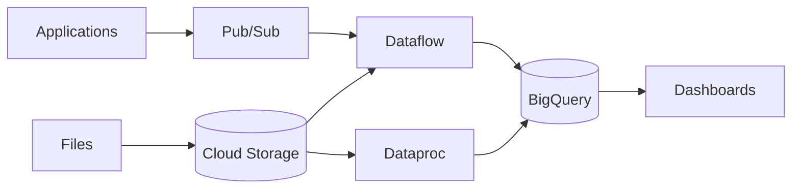

# GCP Platform — Interview Question Bank

*(Cross-service GCP questions: choosing storage and processing services, IAM, governance and security. Service-specific questions are in the other files in this folder.)*

> Format: Question · Answer · Follow-ups · Difficulty

---

### Q1: What does each core data service do: Cloud Storage, BigQuery, Dataflow, Dataproc and Pub/Sub?

**Answer:**
| Service | Role | Typical use |
|---|---|---|
| **Cloud Storage** | Object storage | Landing zone, data lake, archives, files of any format |
| **Pub/Sub** | Messaging / event ingestion | Decoupling producers and consumers, streaming input |
| **Dataflow** | Managed Apache Beam (batch and streaming) | Streaming pipelines, large transformations, windowing |
| **Dataproc** | Managed Spark/Hadoop | Existing Spark jobs, ML with Spark, lift-and-shift Hadoop |
| **BigQuery** | Serverless data warehouse | Analytics SQL, reporting, ELT transformations, BigQuery ML |

A common combination: events → **Pub/Sub** → **Dataflow** → **BigQuery**, with raw copies in **Cloud Storage** and batch Spark jobs on **Dataproc**.

**Follow-ups:**
- When would you load straight into BigQuery and skip Dataflow?
- What would make you pick Dataproc over Dataflow for a new pipeline?

**Difficulty:** Easy

---

### Q2: How do you choose between Cloud SQL, BigQuery and Bigtable?

**Answer:**
| | Cloud SQL | BigQuery | Bigtable |
|---|---|---|---|
| Type | Managed MySQL / PostgreSQL / SQL Server | Serverless columnar warehouse | Wide-column NoSQL |
| Workload | OLTP: many small reads and writes, transactions | OLAP: large scans and aggregations | Very high-throughput key lookups and writes |
| Query | Full SQL, indexes, joins | SQL over huge tables; no indexes needed | Lookups and scans by row key |
| Scale | Vertical (plus read replicas) | Petabytes, automatic | Petabytes, add nodes linearly |
| Latency | Milliseconds per row | Seconds per query | Single-digit milliseconds |

Rule of thumb: **application database → Cloud SQL** (or AlloyDB / Spanner at larger scale), **analytics → BigQuery**, **time-series or IoT at massive scale with key-based access → Bigtable**.

**Follow-ups:**
- When would you choose Spanner instead of Cloud SQL?
- How would you move data from Cloud SQL into BigQuery continuously?

**Difficulty:** Medium

---

### Q3: What is Bigtable, and how do you design its row key?

**Answer:**
Bigtable is a managed wide-column NoSQL database built for very high read and write throughput with low latency. Data is sorted by **row key**, which is the only index, and rows are split into tablets across nodes.

Row key design is the most important decision:
- Put the field you query by first, e.g. `device_id#reverse_timestamp`, so a device's latest readings are adjacent.
- **Avoid monotonically increasing prefixes** (plain timestamps, sequential IDs). All writes would land on one node, creating a hotspot.
- Keep keys short, and group related columns into column families.

Bigtable gives single-row atomicity only, so it isn't a fit for multi-row transactions or ad-hoc joins.

**Follow-ups:**
- How would you design a key to query "all readings for a device in the last hour"?
- How would you analyze Bigtable data with SQL?

**Difficulty:** Medium

---

### Q4: What is Dataplex?

**Answer:**
Dataplex is Google Cloud's data governance and management layer across Cloud Storage and BigQuery. It organizes data into **lakes, zones and assets** without moving it, and provides:
- **Catalog and search** (Dataplex Catalog, formerly Data Catalog), with business metadata and tags
- **Data profiling and data quality scans**, with rules and scheduled checks
- **Data lineage** across BigQuery, Dataflow, Composer and other services
- Centralized **security and policy** management across zones

It's useful when many teams share a data lake and you need discoverability, quality checks and consistent access policies.

**Follow-ups:**
- How would you use Dataplex data quality scans in a pipeline?
- How does lineage help during an incident?

**Difficulty:** Medium

---

### Q5: Explain IAM in Google Cloud: role types, hierarchy and best practices.

**Answer:**
IAM answers **who** (principal) can do **what** (role = set of permissions) on **which resource**.
- **Principals:** Google accounts, groups, service accounts, workforce or workload identities.
- **Role types:** **basic** (Owner, Editor, Viewer: too broad for production), **predefined** (e.g. `roles/bigquery.dataViewer`) and **custom** roles.
- **Hierarchy:** policies set on an organization, folder or project are **inherited** by everything below; you can also grant on individual resources such as a dataset or bucket.
- **Conditions:** grant access only under conditions, e.g. until a date or for a resource-name prefix.

Best practices: least privilege, grant to **groups** rather than individuals, one service account per workload, no service account keys (use Workload Identity), and review with IAM Recommender and audit logs.

**Follow-ups:**
- Why should a pipeline run as a service account rather than a user?
- How would you give a team read access to one BigQuery dataset only?

**Difficulty:** Easy

---

### Q6: What is PII, and how do you protect it in a GCP data platform?

**Answer:**
PII (personally identifiable information) is data that identifies a person directly (name, email, phone, national ID) or in combination with other fields (date of birth plus postcode). Protecting it on GCP:
1. **Discover:** scan Cloud Storage and BigQuery with **Sensitive Data Protection** (Cloud DLP) to find PII.
2. **Minimize and de-identify:** drop what you don't need; mask, tokenize or hash the rest (DLP de-identification, format-preserving encryption).
3. **Restrict access:** BigQuery **policy tags** for column-level security and **dynamic data masking**, **row access policies**, and authorized views.
4. **Encrypt:** encrypted at rest by default; use **CMEK** if required.
5. **Contain and audit:** VPC Service Controls against exfiltration, and Cloud Audit Logs for data access.
6. **Retention:** expiration and deletion processes for regulations such as GDPR.

**Follow-ups:**
- How would you let analysts join on email without seeing the email?
- How do you handle a "right to be forgotten" request across raw and curated layers?

**Difficulty:** Medium

---

### Q7: How do you set up logging and monitoring for data pipelines on GCP?

**Answer:**
- **Cloud Logging** collects logs from Composer, Dataflow, Dataproc, Cloud Run and functions. Write **structured (JSON) logs** with fields such as `pipeline`, `run_id` and `row_count`.
- **Cloud Monitoring** provides service metrics (Dataflow system lag, Composer task failures, Pub/Sub backlog) plus **log-based metrics** and custom metrics.
- **Alerting policies** notify through email, Slack or PagerDuty, e.g. on DAG failure, SLA miss, backlog age, or job error count.
- **BigQuery** offers `INFORMATION_SCHEMA.JOBS` for query cost and failures, and log sinks to BigQuery for long-term analysis.
- **Cloud Audit Logs** record who accessed or changed what.

Alert on things that need action (failures, SLA risk, data freshness); log the rest.

**Follow-ups:**
- How would you alert when a table hasn't been updated by 6 AM?
- How would you route all pipeline logs into BigQuery for analysis?

**Difficulty:** Medium
