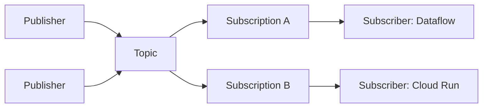

# Pub/Sub — Interview Question Bank

> Format: Question · Answer · Follow-ups · Difficulty

---

### Q1: What is Pub/Sub, and what are its main components?

**Answer:**
Pub/Sub is Google Cloud's fully managed, asynchronous messaging service. Producers and consumers are **decoupled**: they don't need to know about each other or be online at the same time.

- **Publisher:** sends messages to a topic.
- **Topic:** a named channel that receives messages.
- **Subscription:** a named stream of messages from one topic to a consumer. **Each subscription gets its own copy** of every message.
- **Subscriber:** reads messages from a subscription and acknowledges them.

**Follow-ups:**
- How do you fan out the same events to two independent consumers?
- How does Pub/Sub compare with Kafka?

**Difficulty:** Easy

---

### Q2: What's the difference between pull and push subscriptions?

**Answer:**
- **Pull:** the subscriber requests messages (streaming pull in client libraries). It controls its own rate, and suits high throughput and Dataflow. This is the most common choice for pipelines.
- **Push:** Pub/Sub sends each message as an HTTPS POST to an endpoint (e.g. Cloud Run). A 2xx response acknowledges it. Good for serverless, event-driven handlers, and it scales with the endpoint.

There are also **export subscriptions** that write directly to **BigQuery** or **Cloud Storage** without any subscriber code.

**Follow-ups:**
- How would you secure a push endpoint?
- When would a BigQuery subscription replace a Dataflow job?

**Difficulty:** Easy

---

### Q3: What happens if a subscriber doesn't acknowledge a message?

**Answer:**
Every delivered message has an **acknowledgement deadline** (10 seconds by default, up to 600 seconds; client libraries extend it automatically while processing). If the message isn't acked before the deadline, or is nacked, Pub/Sub **redelivers** it. Unacked messages are retained (7 days by default) until they're acked or expire.

That's why subscribers must be **idempotent**: the same message can arrive more than once.

**Follow-ups:**
- What would cause the same message to be processed repeatedly?
- How do you make writes to BigQuery idempotent for redelivered messages?

**Difficulty:** Easy

---

### Q4: What delivery and ordering guarantees does Pub/Sub provide?

**Answer:**
- **At-least-once delivery** by default: duplicates are possible.
- **Exactly-once delivery** can be enabled on pull subscriptions (within a region). Acks then succeed only once, and redelivery after a successful ack doesn't happen.
- **Ordering:** no global order by default. With **ordering keys**, messages with the same key are delivered in publish order to subscriptions that enable message ordering.

Even with these features, design consumers to tolerate duplicates, e.g. by using a message ID or business key for dedupe.

**Follow-ups:**
- What's the throughput trade-off of ordering keys?
- How does Dataflow deduplicate Pub/Sub messages?

**Difficulty:** Medium

---

### Q5: What is a dead-letter topic, and how do you use it?

**Answer:**
A dead-letter topic receives messages that a subscription failed to process after a set number of delivery attempts (5–100). It stops one bad message (a "poison pill") from being retried forever and blocking progress.

Setup: create the dead-letter topic with its own subscription, set `--dead-letter-topic` and `--max-delivery-attempts` on the main subscription, and grant the Pub/Sub service account publish and subscribe permissions. Then monitor the dead-letter subscription, fix the cause, and **replay** the messages back to the main topic.

**Follow-ups:**
- What information would you add to messages to make dead-letter triage easier?
- How do retry policies (exponential backoff) interact with dead-lettering?

**Difficulty:** Medium

---

### Q6: How do you replay messages in Pub/Sub?

**Answer:**
- **Seek to a timestamp:** rewind a subscription so that messages published after that time are redelivered. This needs `retain_acked_messages` enabled, or topic message retention.
- **Snapshots:** capture a subscription's ack state before a risky deployment, then seek back to the snapshot if the new code misbehaves.
- **Topic retention** (up to 31 days) lets new subscriptions read older messages.

Replay is how you reprocess after a consumer bug, so pair it with idempotent sinks.

**Follow-ups:**
- What would you check before seeking a production subscription back by a day?
- How long does a snapshot last?

**Difficulty:** Hard
