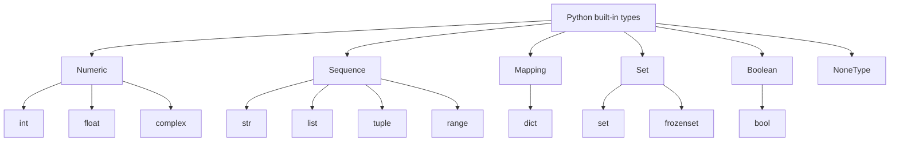

# Python for Data Engineers — Interview Question Bank

> Format: Question · Answer · Follow-ups · Difficulty

---

### Q1: What's the difference between a list, tuple, set, and dictionary — and when would you use each in a pipeline?

**Answer:**
- **List**: ordered, mutable, allows duplicates → row buffers, ordered batches.
- **Tuple**: ordered, immutable → fixed-schema records, dict keys, function returns you don't want mutated.
- **Set**: unordered, unique elements, O(1) average membership check → deduping IDs, fast "seen before" lookups.
- **Dict**: key-value, O(1) average lookup → lookups/joins in memory, counters, schema mapping.

**Follow-ups:**
- Why can a tuple be a dict key but a list can't?
- What's the time complexity of `x in list` vs `x in set`?

**Difficulty:** Easy

---

### Q2: Explain generators vs list comprehensions. Why do they matter for large datasets?

**Answer:**
A list comprehension builds the entire list in memory immediately. A generator (`(x for x in ...)` or a function with `yield`) produces items lazily, one at a time, using O(1) memory regardless of size.

```python
# Loads everything into memory
rows = [transform(r) for r in read_huge_file()]

# Streams row by row — constant memory
rows = (transform(r) for r in read_huge_file())
for r in rows:
    process(r)
```
For ETL over files that don't fit in memory, generators (and generator pipelines) are essential.

**Follow-ups:**
- What happens if you iterate over a generator twice?
- How would you chain generators to build a streaming ETL pipeline?

**Difficulty:** Easy

---

### Q3: What is the GIL and how does it affect multithreading vs multiprocessing in Python?

**Answer:**
The **Global Interpreter Lock** allows only one thread to execute Python bytecode at a time in CPython.
- **Threading** (`threading` module) is still useful for **I/O-bound** work (API calls, DB/file reads) because the GIL is released during I/O waits.
- **Multiprocessing** (`multiprocessing` module) spawns separate processes with their own interpreter/memory, giving true parallelism for **CPU-bound** work (e.g., heavy transformations, compression).
- For CPU-bound parallel data processing, prefer `multiprocessing`, `concurrent.futures.ProcessPoolExecutor`, or offload to Spark/Dataflow.

**Follow-ups:**
- Does the GIL slow down I/O-bound work such as API calls?
- How does `asyncio` compare with threads for concurrent ingestion?

**Difficulty:** Medium

---

### Q4: What are `*args` and `**kwargs`? Give a data-engineering example.

**Answer:**
`*args` collects extra positional arguments into a tuple; `**kwargs` collects extra keyword arguments into a dict. Useful for writing generic wrapper functions, e.g. a retry decorator that must forward any function's arguments:
```python
def retry(func):
    def wrapper(*args, **kwargs):
        for attempt in range(3):
            try:
                return func(*args, **kwargs)
            except Exception as e:
                last_err = e
        raise last_err
    return wrapper
```

**Follow-ups:**
- In what order must regular args, `*args`, keyword-only args and `**kwargs` appear?
- How would you forward `**kwargs` to a wrapped function?

**Difficulty:** Easy

---

### Q5: What's wrong with using a mutable default argument, e.g. `def f(items=[]):`?

**Answer:**
Default argument objects are created **once**, at function definition time, and reused across calls — so a mutable default accumulates state across calls, which is almost never intended.
```python
def add_item(item, items=[]):   # BUG
    items.append(item)
    return items
# Fix:
def add_item(item, items=None):
    items = items if items is not None else []
    items.append(item)
    return items
```

**Follow-ups:**
- When exactly is a default argument evaluated?
- What's the idiomatic fix, and why does `None` work?

**Difficulty:** Easy

---

### Q6: Explain decorators and write one that logs the runtime of a function.

**Answer:**
A decorator wraps a function to add behavior without changing its code.
```python
import time, functools

def timed(func):
    @functools.wraps(func)
    def wrapper(*args, **kwargs):
        start = time.time()
        result = func(*args, **kwargs)
        print(f"{func.__name__} took {time.time()-start:.2f}s")
        return result
    return wrapper

@timed
def load_data(path):
    ...
```
Common in pipelines for logging, retries, caching, and access control around task functions.

**Follow-ups:**
- Why use `functools.wraps` inside a decorator?
- How would you write a decorator that takes arguments, e.g. `@retry(times=3)`?

**Difficulty:** Medium

---

### Q7: What are context managers? Why use `with open(...) as f` instead of manually opening/closing files?

**Answer:**
A context manager guarantees setup/teardown code runs (via `__enter__`/`__exit__`), even if an exception occurs — so resources like files, DB connections, or locks are always released.
```python
with open("data.csv") as f:
    for line in f:
        process(line)
# file is closed automatically, even on error
```
You can write your own with a class (`__enter__`/`__exit__`) or `@contextlib.contextmanager`.

**Follow-ups:**
- How do you write your own context manager with `contextlib`?
- What happens to an exception raised inside a `with` block?

**Difficulty:** Easy

---

### Q8: Difference between shallow copy and deep copy?

**Answer:**
- `copy.copy(obj)` (shallow): copies the outer object; nested objects are still shared references.
- `copy.deepcopy(obj)`: recursively copies everything, so nested objects are fully independent.
```python
import copy
a = {"nums": [1, 2, 3]}
b = copy.copy(a)
b["nums"].append(4)
print(a["nums"])  # [1, 2, 3, 4] -- shared reference!

c = copy.deepcopy(a)
c["nums"].append(5)
print(a["nums"])  # unaffected
```

**Follow-ups:**
- When can a shallow copy cause a bug in a transformation?
- How does `copy.deepcopy` handle circular references?

**Difficulty:** Easy

---

### Q9: How would you efficiently read a 10 GB CSV file that doesn't fit in memory?

**Answer:**
- Stream it line-by-line or in chunks rather than loading it all at once.
```python
import pandas as pd
for chunk in pd.read_csv("huge.csv", chunksize=100_000):
    process(chunk)
```
- Alternatives: plain Python file iteration (`for line in f`), `csv.reader`, or push the work to a distributed engine (PySpark/Dataflow) if it's routinely this large.
- Also consider: reading only needed columns (`usecols`), using efficient dtypes, or converting to a columnar format (Parquet) up front.

**Follow-ups:**
- How would you choose a chunk size?
- When would you switch from pandas to Polars, DuckDB or Spark?

**Difficulty:** Medium

---

### Q10: `map`, `filter`, `reduce`, and list comprehensions — when would you pick each?

**Answer:**
```python
nums = [1, 2, 3, 4, 5]
squared = list(map(lambda x: x**2, nums))          # or [x**2 for x in nums]
evens   = list(filter(lambda x: x % 2 == 0, nums))  # or [x for x in nums if x % 2 == 0]

from functools import reduce
total = reduce(lambda a, b: a + b, nums)            # or sum(nums)
```
In practice, comprehensions are usually more readable than `map`/`filter` in Python; `reduce` is used for accumulation logic without an obvious built-in. In real pipelines, prefer built-ins (`sum`, `max`, `sorted`) when they exist.

**Follow-ups:**
- Why are list comprehensions usually preferred over `map` with `lambda`?
- Give a case where `reduce` is clearer than a loop.

**Difficulty:** Easy

---

### Q11: How do you handle exceptions gracefully in a data pipeline task?

**Answer:**
```python
import logging

def extract(source):
    try:
        return fetch(source)
    except ConnectionError as e:
        logging.error(f"Connection failed for {source}: {e}")
        raise  # let orchestrator (Airflow) retry
    except ValueError as e:
        logging.warning(f"Bad data from {source}, skipping: {e}")
        return None
    finally:
        cleanup()
```
Key principles: catch specific exceptions (not bare `except:`), log with context, decide whether to fail the task (re-raise, let the orchestrator retry) or skip-and-continue, and always release resources in `finally` or a context manager.

**Follow-ups:**
- Which errors should be retried and which should fail fast?
- How do you avoid swallowing exceptions with a bare `except`?

**Difficulty:** Medium

---

### Q12: What's the difference between `==` and `is`?

**Answer:**
`==` compares **values** (calls `__eq__`); `is` compares **object identity** (same memory address). Use `is` for `None`/singleton checks (`if x is None:`), `==` for value comparison.

**Follow-ups:**
- Why does `a is b` sometimes return True for small integers?
- Why should you write `x is None` rather than `x == None`?

**Difficulty:** Easy

---

### Q13: Explain Python's data classes (`@dataclass`) and why they're handy for schema-like objects.

**Answer:**
`@dataclass` auto-generates `__init__`, `__repr__`, and `__eq__` for classes that are mostly data containers — good for representing structured records or config objects.
```python
from dataclasses import dataclass

@dataclass
class Event:
    user_id: int
    event_type: str
    ts: str
    amount: float = 0.0
```

**Follow-ups:**
- What do `frozen=True` and `slots=True` do?
- How does a dataclass compare with Pydantic for validating incoming records?

**Difficulty:** Easy

---

### Q14: How would you deduplicate a list while preserving order?

**Answer:**
```python
def dedupe(items):
    seen = set()
    result = []
    for item in items:
        if item not in seen:
            seen.add(item)
            result.append(item)
    return result
```
(For Python 3.7+, `list(dict.fromkeys(items))` also works and preserves order.)

**Follow-ups:**
- Why does `dict.fromkeys` preserve order?
- How would you dedupe by one field of a dict rather than the whole record?

**Difficulty:** Easy

---

### Q15: Write a function to flatten an arbitrarily nested list.

**Answer:**
```python
def flatten(nested):
    result = []
    for item in nested:
        if isinstance(item, list):
            result.extend(flatten(item))
        else:
            result.append(item)
    return result

flatten([1, [2, [3, 4], 5], 6])  # [1, 2, 3, 4, 5, 6]
```

**Follow-ups:**
- How would you avoid recursion-depth limits on very deep nesting?
- How would you make it a generator instead of building a list?

**Difficulty:** Medium

---

### Q16: How do you connect to and query a database from Python, and why use parameterized queries?

**Answer:**
```python
import psycopg2

conn = psycopg2.connect(dsn)
with conn.cursor() as cur:
    cur.execute("SELECT * FROM orders WHERE customer_id = %s", (customer_id,))
    rows = cur.fetchall()
```
Parameterized queries (placeholders, not string formatting) prevent SQL injection and let the DB driver handle type escaping correctly.

**Follow-ups:**
- What's SQL injection, and how do parameterized queries prevent it?
- How would you bulk-insert 1M rows efficiently?

**Difficulty:** Medium

---

### Q17: What are Python virtual environments and why do pipelines need them?

**Answer:**
A virtual environment (`venv`, `conda`, `poetry`) isolates a project's dependencies from the system Python and from other projects, so version conflicts don't break unrelated jobs. In production data pipelines, this is usually handled by pinning dependencies in a `requirements.txt`/`pyproject.toml` and building a container image or Airflow/Composer PyPI package list from it.

**Follow-ups:**
- How do `venv`, Poetry and conda differ?
- How do you pin dependencies for a reproducible deployment?

**Difficulty:** Easy

---

### Q18: What's the difference between `@staticmethod`, `@classmethod`, and a regular instance method?

**Answer:**
- **Instance method**: takes `self`, operates on a specific object.
- **`@classmethod`**: takes `cls`, operates on the class itself (e.g., alternate constructors like `from_json`).
- **`@staticmethod`**: takes neither; it's just a function namespaced inside the class for organization.
```python
class Config:
    def __init__(self, path):
        self.path = path

    @classmethod
    def from_env(cls):
        return cls(os.environ["CONFIG_PATH"])

    @staticmethod
    def validate(path):
        return path.endswith(".yaml")
```

**Follow-ups:**
- When would you use a `classmethod` as an alternative constructor?
- Can a static method access instance state?

**Difficulty:** Easy

---

### Q19: How do you parse and manipulate dates/timestamps in Python, and what pitfalls should you watch for?

**Answer:**
```python
from datetime import datetime, timezone

dt = datetime.strptime("2024-01-15 10:30:00", "%Y-%m-%d %H:%M:%S")
dt_utc = dt.replace(tzinfo=timezone.utc)
```
Pitfalls: naive vs timezone-aware datetimes getting mixed together, daylight-saving edge cases, and inconsistent timestamp formats/units (seconds vs milliseconds vs ISO strings) across source systems — always normalize to UTC as early as possible in a pipeline.

**Follow-ups:**
- Why should you store timestamps in UTC?
- How do you handle daylight-saving transitions in daily partitions?

**Difficulty:** Medium

---

### Q20: How would you write a simple unit test for a transformation function?

**Answer:**
```python
import unittest

def clean_email(email):
    return email.strip().lower()

class TestCleanEmail(unittest.TestCase):
    def test_strips_and_lowercases(self):
        self.assertEqual(clean_email("  User@Example.COM  "), "user@example.com")

    def test_empty_string(self):
        self.assertEqual(clean_email(""), "")

if __name__ == "__main__":
    unittest.main()
```
(`pytest` is the more common modern tool — same idea, less boilerplate: plain `assert` statements, `test_*.py` files auto-discovered.)

**Follow-ups:**
- How would you test a function that reads from GCS or a database?
- What's the difference between a unit test and an integration test for a pipeline?

**Difficulty:** Easy

---

### Q21: Coding: given a list of dicts (records), group them by a key and compute an aggregate.

**Answer:**
```python
from collections import defaultdict

records = [
    {"region": "us", "amount": 100},
    {"region": "eu", "amount": 50},
    {"region": "us", "amount": 30},
]

totals = defaultdict(float)
for r in records:
    totals[r["region"]] += r["amount"]

print(dict(totals))  # {'us': 130.0, 'eu': 50.0}
```

**Follow-ups:**
- How would you do this with `itertools.groupby`, and what's the catch?
- How would you do it if the data didn't fit in memory?

**Difficulty:** Medium

---

### Q22: What is memory-efficient iteration with `itertools`, and give a pipeline use case?

**Answer:**
`itertools` provides lazy, composable iterators without building intermediate lists — e.g. `itertools.islice` to page through a huge iterable, `itertools.chain` to concatenate iterators without copying, `itertools.groupby` to group consecutive items (note: requires pre-sorted input, unlike SQL `GROUP BY`).
```python
from itertools import islice
first_1000 = list(islice(read_huge_generator(), 1000))
```

**Follow-ups:**
- How does `itertools.islice` help with batching?
- Write a function that yields fixed-size batches from any iterable.

**Difficulty:** Medium

---

### Q23: What are Python's built-in data types?

**Answer:**


- **Numeric:** `int` (arbitrary precision), `float`, `complex`. Use `decimal.Decimal` for money.
- **Sequences:** `str` (immutable text), `list` (mutable), `tuple` (immutable), `range`.
- **Mapping:** `dict` (insertion-ordered since 3.7).
- **Sets:** `set` (mutable), `frozenset` (immutable, hashable).
- **Boolean:** `bool` (a subclass of `int`). Plus **`None`**, and `bytes` / `bytearray` for binary data.

**Follow-ups:**
- Why shouldn't you use `float` for currency amounts?
- Which of these types can be dictionary keys, and why?

**Difficulty:** Easy

---

### Q24: Why is Python called an interpreted language?

**Answer:**
You run source code directly, with no separate compile-and-link step. Under the hood, CPython **compiles source to bytecode** (cached as `.pyc` files) and the **Python virtual machine** executes that bytecode instruction by instruction. Errors such as a `NameError` surface at runtime when the line executes, and types are checked dynamically.

Consequences: fast iteration and portability, but slower CPU-bound execution than compiled languages. That's why heavy numeric work is pushed into C-backed libraries (NumPy, pandas, Arrow) or distributed engines (Spark).

**Follow-ups:**
- What's the difference between CPython and PyPy?
- Why does vectorized pandas code run faster than a Python loop?

**Difficulty:** Easy

---

### Q25: What's the difference between a module and a package?

**Answer:**
- A **module** is a single `.py` file (e.g. `utils.py`), imported with `import utils`.
- A **package** is a directory of modules, traditionally with an `__init__.py`, imported with dotted paths (`from pipelines.transforms import clean`).
- A **distribution** (wheel) is how packages are shipped and installed with `pip`.

In data projects, organize reusable logic (readers, validators, BigQuery helpers) into a package with tests, instead of copying functions between DAG files or notebooks.

**Follow-ups:**
- What does `if __name__ == "__main__":` do?
- How would you share a common package across Composer DAGs?

**Difficulty:** Easy

---

### Q26: What are mutable and immutable objects, and why does it matter?

**Answer:**
- **Immutable:** cannot change after creation: `int`, `float`, `str`, `tuple`, `frozenset`, `bytes`. "Modifying" one creates a new object.
- **Mutable:** can change in place: `list`, `dict`, `set`, most custom objects.

Why it matters:
- Only hashable (generally immutable) objects can be **dict keys or set members**.
- Mutable objects passed into functions can be **changed by the callee**: the caller sees the change.
- A **mutable default argument** is shared across calls.
- Immutable objects are safe to share between threads.

```python
a = [1, 2]
b = a           # same object
b.append(3)
print(a)        # [1, 2, 3]
```

**Follow-ups:**
- Is a tuple containing a list hashable?
- How do you avoid accidentally mutating an input record in a transformation?

**Difficulty:** Easy

---

### Q27: How do indexing, negative indexing and slicing work?

**Answer:**
Indexes start at `0`; negative indexes count from the end (`-1` is the last element). Slicing is `seq[start:stop:step]`, where `stop` is exclusive.

```python
fruits = ["apple", "banana", "cherry", "date"]
fruits[0], fruits[-1]      # ('apple', 'date')
fruits[1:3]                # ['banana', 'cherry']
fruits[:2], fruits[2:]     # ['apple', 'banana'], ['cherry', 'date']
fruits[::-1]               # reversed copy
fruits[::2]                # every second element
```

Slicing returns a **new** list (a shallow copy), and out-of-range slices don't raise errors.

**Follow-ups:**
- What does `s[-3:]` return for a string shorter than 3 characters?
- How would you get the last 7 elements of a list of daily values?

**Difficulty:** Easy

---

### Q28: Explain the four pillars of OOP with a data-engineering example.

**Answer:**
```python
from abc import ABC, abstractmethod

class Source(ABC):                       # Abstraction: a common interface
    @abstractmethod
    def read(self): ...

class CsvSource(Source):                 # Inheritance
    def __init__(self, path):
        self._path = path                # Encapsulation: internal detail
    def read(self):
        return f"rows from {self._path}"

class ApiSource(Source):
    def __init__(self, url):
        self._url = url
    def read(self):
        return f"rows from {self._url}"

for src in [CsvSource("gs://bucket/a.csv"), ApiSource("https://api.example.com/items")]:
    print(src.read())                    # Polymorphism: same call, different behavior
```

- **Encapsulation:** hide internal state behind methods (`_path`).
- **Abstraction:** define *what* a source does (`read`), not *how*.
- **Inheritance:** concrete sources reuse and extend the base class.
- **Polymorphism:** pipeline code calls `read()` on any source without knowing its type.

**Follow-ups:**
- When would composition be better than inheritance here?
- What do `@property` and name mangling (`__attr`) do?

**Difficulty:** Medium

---

### Q29: How do you read data from a paginated REST API reliably?

**Answer:**
Use a session with **timeouts, retries with backoff**, and loop over pages until there are no more:

```python
import requests
from requests.adapters import HTTPAdapter
from urllib3.util.retry import Retry

def fetch_all(url, token):
    session = requests.Session()
    retry = Retry(total=5, backoff_factor=1, status_forcelist=[429, 500, 502, 503, 504])
    session.mount("https://", HTTPAdapter(max_retries=retry))
    headers = {"Authorization": f"Bearer {token}"}
    params = {"page_size": 500}
    while url:
        resp = session.get(url, headers=headers, params=params, timeout=30)
        resp.raise_for_status()
        body = resp.json()
        yield from body["items"]            # stream records instead of building one big list
        url, params = body.get("next"), None  # follow the next-page link
```

Also: keep the token in Secret Manager, respect rate limits (`Retry-After`), checkpoint the last page or watermark for incremental loads, and land the raw responses in Cloud Storage before transforming them.

**Follow-ups:**
- How would you load only records changed since the last run?
- How would you parallelize the calls without hitting rate limits?

**Difficulty:** Medium

---

### Q30: How do you add logging to a Python pipeline?

**Answer:**
Use the standard `logging` module (not `print`), with levels and a consistent format:

```python
import logging

logging.basicConfig(level=logging.INFO, format="%(asctime)s %(levelname)s %(name)s %(message)s")
log = logging.getLogger("orders_pipeline")

log.info("Loaded %d rows from %s", 1200, "gs://bucket/orders.csv")
log.warning("Skipped %d rows with missing order_id", 3)
try:
    1 / 0
except ZeroDivisionError:
    log.exception("Transform failed")      # logs the stack trace at ERROR level
```

Good practice: log counts, run IDs and parameters at INFO, problems at WARNING and ERROR; never log secrets or PII; on GCP, emit **structured JSON** so Cloud Logging can filter on fields and build log-based metrics.

**Follow-ups:**
- Why use `%s` placeholders instead of f-strings in log calls?
- How would you alert on an ERROR log from a pipeline?

**Difficulty:** Easy

---

### Q31: Which Python libraries do you use in data engineering work?

**Answer:**
Group them by job and say what you used each for:
- **Data manipulation:** pandas, Polars, PyArrow
- **Distributed processing:** PySpark, Apache Beam
- **GCP:** `google-cloud-bigquery`, `google-cloud-storage`, `google-cloud-pubsub`, `google-cloud-secret-manager`
- **Orchestration:** Apache Airflow (providers)
- **Databases and APIs:** SQLAlchemy, `psycopg`, `requests`
- **Validation and testing:** Pydantic, Great Expectations, pytest
- **Config and utilities:** PyYAML, `python-dotenv`, `logging`

Then give one concrete example, e.g. "I used `google-cloud-storage` and pandas to validate incoming files, and the BigQuery client to load them with a schema."

**Follow-ups:**
- When would you choose Polars over pandas?
- How do you manage library versions in Composer?

**Difficulty:** Easy

---

### Q32: Coding: count how many times each character occurs in a string.

**Answer:**
```python
from collections import Counter

def char_counts(text):
    return Counter(text)

# Without Counter
def char_counts_manual(text):
    counts = {}
    for ch in text:
        counts[ch] = counts.get(ch, 0) + 1
    return counts

print(char_counts("data"))          # Counter({'a': 2, 'd': 1, 't': 1})
```

O(n) time. To ignore case or spaces, normalize first: `Counter(text.lower().replace(" ", ""))`.

**Follow-ups:**
- How would you return the most common character?
- How would you find the first non-repeating character?

**Difficulty:** Easy

---

### Q33: Coding: swap the case of every letter without using `swapcase()`.

**Answer:**
```python
def swap_case(text):
    return "".join(ch.lower() if ch.isupper() else ch.upper() for ch in text)

print(swap_case("Data Eng 101"))    # dATA eNG 101
```

Non-letters are unchanged, because `upper()` and `lower()` leave them alone. Building a list and joining it avoids repeated string concatenation, which is O(n²).

**Follow-ups:**
- Why is `"".join(...)` preferred over `+=` in a loop?
- How would you do this with `str.translate`?

**Difficulty:** Easy

---

### Q34: Coding: common list manipulations.

**Answer:**
```python
nums = [1, 2, 3, 4]
nums[::-1]                                   # reverse: [4, 3, 2, 1]
[x * x for x in nums]                        # squares: [1, 4, 9, 16]

a, b = ["My", "name"], ["is", "Sam"]
[x + y for x, y in zip(a, b)]                # index-wise concat: ['Myis', 'nameSam']

first, second = ["Hello ", "Bye "], ["Dear", "Sir"]
[x + y for x in first for y in second]       # every combination: ['Hello Dear', 'Hello Sir', 'Bye Dear', 'Bye Sir']
```

`zip` pairs elements by position and stops at the shorter list (use `itertools.zip_longest` to keep going). A nested comprehension produces every combination, like a SQL cross join.

**Follow-ups:**
- What's the difference between `reversed(nums)`, `nums.reverse()` and `nums[::-1]`?
- How would you flatten a list of lists?

**Difficulty:** Easy
