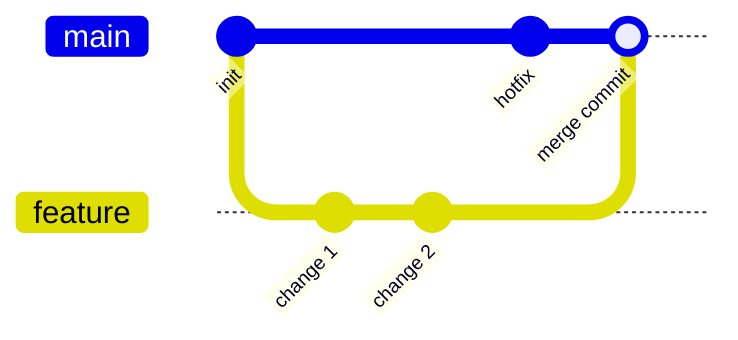

# Real-World Asked: DevOps & CI/CD

Git, CI/CD and deployment questions reported from real interviews.

See [README.md](README.md) for the layout and contributor rules. Fields are left blank when unknown.

## Deloitte

### Q1: How do you resolve a merge conflict in Git or GitHub?

**Answer:**
`git merge` integrates another branch's changes into the current branch. If the branches have diverged, Git creates a **merge commit** with two parents; if the current branch has no new commits, it simply moves the pointer forward (**fast-forward**).

A **conflict** happens when both branches changed the same lines. Git marks them (`<<<<<<<`, `=======`, `>>>>>>>`); you edit the file to the correct result, then `git add` it and `git commit` (or `git merge --continue`). Abort with `git merge --abort`.

**Follow-ups:**
- What's the difference between a merge commit, a squash merge and a rebase?
- How do you reduce merge conflicts on a busy repository?

**Difficulty:** Easy

**Role:** Azure Data Engineer

**Round:** Round 2 – Technical + Managerial

**Asked:** 

## HCLTech

### Q2: How would you build CI/CD pipelines for Databricks code and Azure Data Factory?

**Also asked at:** Deloitte, JPMorgan

**Answer:**
**ADF:**
- Connect the **development** factory to Git (Azure Repos or GitHub); developers work in feature branches and merge through pull requests.
- On merge, build the **ARM templates** automatically with the `@microsoft/azure-data-factory-utilities` npm package (instead of the manual Publish button), then deploy to test and prod with an Azure DevOps or GitHub Actions pipeline, overriding environment parameters (linked services, Key Vault URLs).
- Stop triggers before deployment and restart them after (Microsoft's pre/post-deployment script).

**Databricks:**
- Code in Git folders (notebooks or Python packages), with tests (pytest) and linting in CI.
- Deploy jobs, pipelines and configuration with **Databricks Asset Bundles** (`databricks bundle validate / deploy -t prod`) per environment, authenticated with a service principal.
- Promote the same artifact dev → test → prod with approvals (environments), and keep secrets in Key Vault-backed scopes.

Infrastructure (workspaces, storage, Key Vault) is provisioned with Terraform or Bicep.

**Follow-ups:**
- Why use automated ARM template generation instead of the Publish button?
- How do you handle environment-specific values across dev and prod?

**Difficulty:** Medium

**Role:** Lead Data Engineer

**Round:** Round 2 – Technical

**Asked:** 
