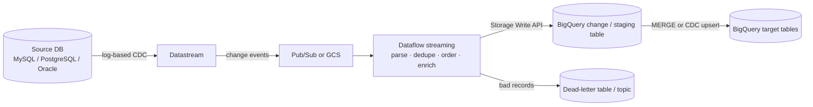

# Real-World Asked: GCP

Google Cloud (BigQuery, Cloud Storage, Composer, Dataflow, …) questions reported from real data engineering interviews.

See [README.md](README.md) for the layout and contributor rules. Fields are left blank when unknown.

## Unspecified company

### Q1: Cost of `SELECT *` vs `SELECT * ... LIMIT 10` in BigQuery

In BigQuery, what's the difference between `SELECT * FROM employee` and `SELECT * FROM employee LIMIT 10` in terms of computation, data scanned and cost?

**Answer:**
BigQuery bills on-demand queries by **bytes read from the columns referenced**, not by rows returned. `LIMIT` is applied after the data is read, so on a regular (non-clustered) table both queries read every column of every row and **cost the same**; the `LIMIT` version only returns less data to the client.

| | `SELECT *` | `SELECT * ... LIMIT 10` |
|---|---|---|
| Bytes read / billed | All columns, whole table | Same: all columns, whole table |
| Rows returned | All | 10 |
| Slot time | Full scan | Roughly the same scan |

To look at sample rows cheaply:
- Use the table **Preview** tab, `bq head`, or the `tabledata.list` API: these are free.
- Select only the columns you need: cost scales with the columns referenced.
- Filter on the **partition column** (and clustered columns) so BigQuery can prune data before reading it.
- Check the dry-run estimate ("This query will process X GB") before running.

**Follow-ups:**
- Why can a `WHERE` filter on a clustered column reduce cost, while `LIMIT` doesn't?
- How would you stop analysts from running accidental full scans (`require_partition_filter`, maximum bytes billed)?

**Difficulty:** Easy

**Role:** 

**Round:** 

**Asked:**

## HCLTech

### Q2: What is the correct syntax for querying wildcard tables in BigQuery?

**Answer:**
Put the **whole table reference, including the asterisk, in backticks**, and filter tables with `_TABLE_SUFFIX`:

```sql
SELECT COUNT(*) AS events
FROM `my-project.analytics.events_*`
WHERE _TABLE_SUFFIX BETWEEN '20240101' AND '20240131';
```

Rules: the wildcard can only appear at the end of the table name; the prefix should be as specific as possible (it matches every table starting with it, including unexpected ones); and the matched tables must have compatible schemas. Wildcard tables are mostly for date-sharded tables; prefer partitioned tables for new designs.

**Follow-ups:**
- Why does a short prefix like `events*` sometimes return wrong results?
- How do you migrate date-sharded tables to a partitioned table?

**Difficulty:** Easy


**Role:** 

**Round:** GCP Advanced Assessment

**Asked:** 

---

### Q3: How do you correct a wildcard table query for NOAA GSOD data?

**Answer:**
The usual mistakes are a missing backtick around the wildcard name or filtering the year in the wrong place. Corrected version:

```sql
SELECT stn, MAX(max) AS max_temp
FROM `bigquery-public-data.noaa_gsod.gsod*`
WHERE _TABLE_SUFFIX = '1940'
  AND max != 9999.9          -- 9999.9 marks missing values in this dataset
GROUP BY stn
ORDER BY max_temp DESC
LIMIT 10;
```

- The fully qualified name, including `*`, is inside **one pair of backticks**.
- The year is selected with `_TABLE_SUFFIX` (the part matched by `*`), so only that year's table is scanned.
- For a range of years: `WHERE _TABLE_SUFFIX BETWEEN '1940' AND '1944'`.

**Follow-ups:**
- What happens to cost if you filter on a data column instead of `_TABLE_SUFFIX`?
- How would you return the year as a column in the result?

**Difficulty:** Easy


**Role:** 

**Round:** GCP Advanced Assessment

**Asked:** 

---

### Q4: How would you migrate a CSV column from STRING to TIMESTAMP in BigQuery with minimal migration effort?

**Answer:**
Add a new `TIMESTAMP` column, populate it once from the existing `STRING` column, and point queries at the new column. Existing queries keep working, and future queries don't pay a cast on every run:

```sql
ALTER TABLE dataset.click_stream ADD COLUMN ts TIMESTAMP;

UPDATE dataset.click_stream
SET ts = SAFE_CAST(dt AS TIMESTAMP)
WHERE TRUE;
```

Then validate (`COUNTIF(ts IS NULL AND dt IS NOT NULL)` finds values that didn't parse), update the load process to fill `ts` for new rows, and migrate downstream queries gradually.

Alternatives and trade-offs:
- **A view that casts `dt`:** no migration, but every query pays for the cast and filters on it won't prune efficiently.
- **Recreating the table** (`CREATE TABLE ... AS SELECT ..., CAST(dt AS TIMESTAMP)`): clean result, but more migration effort and downstream changes at once.

**Follow-ups:**
- Why use `SAFE_CAST` instead of `CAST` here?
- How would you make the new column the partitioning column?

**Difficulty:** Medium


**Role:** 

**Round:** GCP Advanced Assessment

**Asked:** 

## TEKsystems

### Q5: Why did you choose Dataflow instead of performing transformations directly in BigQuery?

**Answer:**
Dataflow made sense because the transformations were **streaming and stateful**, not just set-based SQL:
- Records arrived continuously (CDC / Pub/Sub), and needed per-event parsing, validation, enrichment and deduplication before landing.
- Beam gives **windowing, watermarks and late-data handling**, which plain BigQuery SQL on a schedule doesn't.
- Bad records could be routed to a **dead-letter output** instead of failing a whole load job.
- It kept heavy parsing (nested JSON, type casting) off BigQuery slots, and wrote clean, partitioned data in one pass.

When BigQuery alone is the better choice: batch data already landed in BigQuery and the logic is set-based joins and aggregations. Then ELT with scheduled queries, dbt or Dataform is simpler and cheaper, so you choose based on latency, statefulness and how complex the transformation is.

**Follow-ups:**
- When would you move that logic back into BigQuery (ELT)?
- How do you compare the cost of Dataflow workers with BigQuery slots for the same job?

**Difficulty:** Medium


**Role:** GCP Data Engineer

**Round:** Technical evaluation

**Asked:** 

---

### Q6: If a Dataflow pipeline becomes slow, what would you check first?

**Answer:**
Work from the outside in:
1. **Job graph and step metrics:** find the step with the highest wall time and look at **system lag** and **data freshness** (streaming) to locate the bottleneck stage.
2. **Autoscaling:** is the job pinned at `max_num_workers`, or not scaling because of quota (CPUs, IPs)?
3. **Hot keys and skew:** "hot key detected" warnings, or one `GroupByKey` stage much slower than the rest. Fix with combiners, `with_hot_key_fanout`, or salting.
4. **Sinks and sources:** BigQuery write throughput or quota errors, slow external API calls, Pub/Sub backlog growth.
5. **Worker health:** OOM, GC pressure, CPU saturation. Consider larger machine types or smaller side inputs.
6. **Recent changes:** a new version, a bigger input or a schema change.

**Follow-ups:**
- How do you tell whether the slowness is in the source, a transform or the sink?
- What does a steadily growing system lag tell you?

**Difficulty:** Medium


**Role:** GCP Data Engineer

**Round:** Technical evaluation

**Asked:** 

---

### Q7: If BigQuery writes become the bottleneck, how would you optimize them?

**Answer:**
- **Use the right write API:** the **Storage Write API** (default and recommended in recent Beam versions) has higher throughput and lower cost than legacy streaming inserts; for batch, use **file loads**, which are free and handle large volumes.
- **Batch and parallelize:** larger batches per request, more parallel streams; for file loads, fewer and larger files.
- **Avoid per-row DML:** write to a staging table and run one `MERGE` per batch or partition.
- **Partitioning and clustering on the target:** write into partitioned tables and avoid touching many partitions per load.
- **Quotas:** check write and quota errors in logs; request increases or use separate projects for very high throughput.
- **Reduce data:** drop unused columns and pre-aggregate before writing.

**Follow-ups:**
- When is exactly-once Storage Write API mode worth its overhead?
- Why is row-by-row `UPDATE` in BigQuery an anti-pattern?

**Difficulty:** Hard


**Role:** GCP Data Engineer

**Round:** Technical evaluation

**Asked:** 

---

### Q8: How do you handle schema changes during CDC using Cloud Composer?

**Answer:**
Make the orchestration **schema-aware** instead of letting loads fail:
1. **Detect:** compare the incoming schema (from CDC metadata, Avro schema or the first file) with the target table in a Composer task, e.g. a `PythonOperator` using the BigQuery client or `INFORMATION_SCHEMA.COLUMNS`.
2. **Additive changes** (new nullable column): apply automatically with `ALTER TABLE ADD COLUMN`, or load with `schemaUpdateOptions=['ALLOW_FIELD_ADDITION']`.
3. **Breaking changes** (type change, rename, drop): branch (`BranchPythonOperator`) to a quarantine path and alert, then handle through a versioned migration (new column or table, backfill, swap views).
4. **Keep raw data:** land raw CDC events unchanged, so data can be replayed once the schema is fixed.
5. **Contracts:** keep expected schemas in version control and validate them in CI as well.

**Follow-ups:**
- What changes would you auto-apply, and which would you stop and alert on?
- How do views help downstream consumers during a schema change?

**Difficulty:** Hard


**Role:** GCP Data Engineer

**Round:** Technical evaluation

**Asked:** 

---

### Q9: How would you approach migrating a large Teradata data warehouse to BigQuery?

**Answer:**
1. **Assess:** inventory tables, views, macros, stored procedures, BTEQ scripts, ETL jobs and consumers; use query logs to find what's actually used.
2. **Plan:** choose an approach (lift-and-shift the schema first, then optimize), decide the order (by subject area), and set up the target landing zone (projects, IAM, datasets).
3. **Migrate the schema:** translate DDL, map data types, and design partitioning and clustering.
4. **Migrate the data:** historical backfill, then incremental loads.
5. **Translate code:** SQL, procedures and ETL pipelines.
6. **Validate:** row counts, aggregates and hashes; reconcile reports.
7. **Parallel run and cutover:** run both systems, switch consumers, keep a rollback plan.
8. **Optimize and decommission:** tune queries and cost, then retire Teradata.

**Follow-ups:**
- How would you decide which subject area to migrate first?
- What exit criteria would you use for the parallel run?

**Difficulty:** Medium


**Role:** GCP Data Engineer

**Round:** Technical evaluation

**Asked:** 

---

### Q10: How would you efficiently migrate a 3 TB fact table without timeouts?

**Answer:**
Split the work so no single operation is huge:
- **Extract in parallel chunks** by date range or key range, e.g. one file set per month with Teradata TPT, compressed **Avro or Parquet** files of about 100 MB–1 GB each.
- **Stage in Cloud Storage**, then use **batch load jobs** (`bq load` or the Data Transfer Service for Teradata). Load jobs are free, retry-safe and don't time out like long `INSERT ... SELECT` queries.
- **Load per partition** into a date-partitioned, clustered target, using partition decorators or one load per chunk, so a failure only reruns that chunk.
- **Track progress** in a control table (chunk, row count, status) for restartability.
- **Validate per chunk:** row counts and sums against the source before marking it done.

**Follow-ups:**
- How do you load into a specific partition with a load job?
- How would you handle rows that changed in Teradata during the migration?

**Difficulty:** Hard


**Role:** GCP Data Engineer

**Round:** Technical evaluation

**Asked:** 

---

### Q11: How would you optimize a BigQuery query that suddenly becomes slower after adding a JOIN?

**Answer:**
A new join usually means **more data scanned or a bad join shape**:
1. Look at the **execution graph** for the stage that got slow; compare bytes shuffled and records read before and after.
2. **Join explosion:** check that the join keys are unique on the side where they should be. A many-to-many join multiplies rows.
3. **Filter before joining:** apply partition filters and `WHERE` clauses to both sides first, and select only the needed columns.
4. **Join order and size:** put the largest table first so smaller tables can be broadcast; pre-aggregate the big side if possible.
5. **Skewed keys:** NULLs or one dominant key create a long-tail stage. Filter or handle those keys separately.
6. **Matching types:** joining `STRING` to `INT64` with `CAST` prevents optimizations.
7. **Clustering:** cluster both tables on the join key if the join is frequent.

**Follow-ups:**
- How can you spot a many-to-many join from the query plan?
- When would you denormalize instead of joining at query time?

**Difficulty:** Medium


**Role:** GCP Data Engineer

**Round:** Technical evaluation

**Asked:** 

---

### Q12: What would you check first in the BigQuery execution plan?

**Answer:**
In the query plan (the Execution details tab, or `INFORMATION_SCHEMA.JOBS` job stages):
- **Slowest stage:** compare `wait`, `read`, `compute` and `write` time. High *wait* means slot contention; high *compute* means expensive logic.
- **Records read vs written per stage:** a huge read with a tiny output means a missing filter or partition pruning didn't happen.
- **Shuffle and repartition stages:** large shuffles point at big joins or `GROUP BY`; check for spills.
- **Skew:** a stage where max time is far above average means skewed keys.
- **Bytes processed** for the job compared with what you expected from partition filters.

Then act: add partition filters, reduce columns, fix join keys, pre-aggregate, or add reservations if it's slot-bound.

**Follow-ups:**
- What does a large gap between average and maximum stage time indicate?
- How would you query job stage statistics for a scheduled query over time?

**Difficulty:** Medium


**Role:** GCP Data Engineer

**Round:** Technical evaluation

**Asked:** 

---

### Q13: How do you handle large or skewed BigQuery partitions?

**Answer:**
- **Skewed partitions** (one day or partition much bigger than others): consider a finer grain (hourly partitions), or partition on a different column, and **cluster** on the high-cardinality filter columns so BigQuery can prune blocks within the big partition.
- **Too many small partitions:** use monthly or yearly granularity (there's a 10,000-partition limit per table, and tiny partitions add overhead).
- **Very large partitions:** clustering is the main tool; also use partition filters and `require_partition_filter`.
- **Skewed join or aggregation keys inside a partition:** filter out NULL or default keys, or pre-aggregate, and salt if needed.
- **Check the distribution** with `INFORMATION_SCHEMA.PARTITIONS` (row counts and bytes per partition).

**Follow-ups:**
- How do you find the largest partitions of a table?
- When does integer-range partitioning make sense?

**Difficulty:** Hard


**Role:** GCP Data Engineer

**Round:** Technical evaluation

**Asked:** 

---

### Q14: What is the difference between BigQuery slots and slot reservations?

**Answer:**
- **Slots** are units of compute (CPU, memory, I/O) that BigQuery uses to execute query stages. With **on-demand** pricing you pay per TB scanned and share a large pool of slots.
- **Reservations** (capacity pricing, BigQuery editions) are slots you **buy or commit to** and assign to projects, folders or the organization. You pay for slot capacity instead of bytes scanned, with optional **autoscaling**.

| | On-demand | Reservations |
|---|---|---|
| Billing | Per TB processed | Per slot-hour (baseline + autoscale) |
| Capacity | Shared, best effort | Dedicated, predictable |
| Best for | Spiky or low usage | Steady heavy workloads, cost control |

Use separate reservations (e.g. ETL vs BI) with **assignments** so one workload can't starve the other.

**Follow-ups:**
- How do you decide between on-demand and capacity pricing?
- What is idle slot sharing between reservations?

**Difficulty:** Medium


**Role:** GCP Data Engineer

**Round:** Technical evaluation

**Asked:** 

---

### Q15: Explain a simple Airflow operator you have used in a DAG.

**Answer:**
For example, `GCSToBigQueryOperator` to load each day's files:

```python
from airflow.providers.google.cloud.transfers.gcs_to_bigquery import GCSToBigQueryOperator

load_orders = GCSToBigQueryOperator(
    task_id="load_orders",
    bucket="my-landing-bucket",
    source_objects=["orders/{{ ds }}/*.csv"],
    destination_project_dataset_table="my-project.staging.orders${{ ds_nodash }}",  # load into that day's partition
    source_format="CSV",
    skip_leading_rows=1,
    write_disposition="WRITE_TRUNCATE",   # rerun-safe: replaces only this partition
    autodetect=False,
    schema_object="schemas/orders.json",
)
```

Explain why you chose it: a templated date makes reruns and backfills idempotent, and `WRITE_TRUNCATE` on a partition avoids duplicates.

**Follow-ups:**
- Why load into a partition decorator instead of appending?
- How would you add a check that the load produced rows?

**Difficulty:** Easy


**Role:** GCP Data Engineer

**Round:** Technical evaluation

**Asked:** 

---

### Q16: How do you execute a shell script on a Dataproc cluster from Cloud Composer?

**Answer:**
Prefer submitting it as a **Dataproc job**, not over SSH:
- Wrap the logic as a **Pig or Hive `sh` command** or, more commonly, a **PySpark or Spark job** that calls the script, and submit it with `DataprocSubmitJobOperator`.
- Or put the script in Cloud Storage and run it as an **initialization action** (for cluster setup) or through a small PySpark job that uses `subprocess` to run it.

```python
from airflow.providers.google.cloud.operators.dataproc import DataprocSubmitJobOperator

run_script = DataprocSubmitJobOperator(
    task_id="run_script",
    project_id="my-project", region="us-central1",
    job={
        "placement": {"cluster_name": "etl-cluster"},
        "pig_job": {"query_list": {"queries": ["sh gsutil cp gs://my-bucket/scripts/prepare.sh /tmp/ && sh /tmp/prepare.sh"]}},
    },
)
```

If the script must run on the master node interactively (rare), `SSHOperator` works, but it needs SSH keys and network access, and the job isn't tracked by Dataproc.

**Follow-ups:**
- What's the downside of running scripts over SSH from Composer?
- How would you create an ephemeral cluster around this job?

**Difficulty:** Medium


**Role:** GCP Data Engineer

**Round:** Technical evaluation

**Asked:** 

---

### Q17: When would you use SSHOperator versus DataprocSubmitJobOperator?

**Answer:**
| | `DataprocSubmitJobOperator` | `SSHOperator` |
|---|---|---|
| How | Dataproc Jobs API | Opens an SSH session to a VM |
| Tracking | Job ID, logs and status in Dataproc and Airflow | Only the command's exit code and stdout |
| Security | IAM through the service account | SSH keys, firewall rules, OS Login |
| Retries and idempotency | Clean resubmission | Partial state on the VM possible |
| Use for | Spark, PySpark, Hive and Pig jobs on Dataproc | One-off commands on a VM that isn't a Dataproc job |

Default to `DataprocSubmitJobOperator` (with ephemeral clusters through `DataprocCreateClusterOperator` / `DataprocDeleteClusterOperator`). Use `SSHOperator` only for legacy scripts that can't be packaged as a job.

**Follow-ups:**
- How would you migrate a cron job that SSHes into a VM onto Composer?
- How do you pass parameters to a PySpark job from Airflow?

**Difficulty:** Medium


**Role:** GCP Data Engineer

**Round:** Technical evaluation

**Asked:** 

---

### Q18: How do you configure retries, timeouts, and error handling in Airflow?

**Answer:**
Set defaults once in `default_args` and override them per task:

```python
from datetime import timedelta

default_args = {
    "retries": 3,
    "retry_delay": timedelta(minutes=5),
    "retry_exponential_backoff": True,
    "max_retry_delay": timedelta(minutes=30),
    "execution_timeout": timedelta(hours=1),     # kill a hung task
    "on_failure_callback": notify_failure,         # e.g. Slack, email or PagerDuty
}
```

- **Timeouts:** `execution_timeout` per task, `dagrun_timeout` per DAG run, and `timeout` on sensors (with `mode="reschedule"` or deferrable sensors).
- **Error handling:** make tasks **idempotent** so retries are safe; raise `AirflowSkipException` / `AirflowFailException` deliberately; use trigger rules (`all_done`) for cleanup tasks.
- **Alerting:** `on_failure_callback` and SLAs (`sla_miss_callback`), plus Cloud Monitoring alerts on DAG failures in Composer.

**Follow-ups:**
- Which failures should not be retried?
- What's the difference between `execution_timeout` and `dagrun_timeout`?

**Difficulty:** Easy


**Role:** GCP Data Engineer

**Round:** Technical evaluation

**Asked:** 

---

### Q19: How would you design a low-latency CDC pipeline with an SLA of under two minutes?

**Answer:**
- **Capture:** **Datastream** (or Debezium on Kafka) reads the source database logs with seconds of latency.
- **Transport:** Pub/Sub (or Datastream writing to Cloud Storage with notifications).
- **Process:** a **streaming Dataflow** job parses change events, deduplicates them, orders them per key, and writes using the **Storage Write API**.
- **Serve:** write changes into a **staging or change table** in BigQuery and apply them with a frequent micro-batch `MERGE`, or use **BigQuery CDC upserts** (`_CHANGE_TYPE` with primary keys) for near-real-time tables.
- **Meeting the SLA:** keep each stage's latency measured (end-to-end lag metric), autoscale Dataflow, avoid large per-row DML, and alert when lag exceeds about 90 seconds.
- **Reliability:** a dead-letter path, replay from Pub/Sub or Cloud Storage, and idempotent writes.

**Follow-ups:**
- How would you measure end-to-end latency per record?
- Why might a per-event `MERGE` break a 2-minute SLA?

**Difficulty:** Hard


**Role:** GCP Data Engineer

**Round:** Technical evaluation

**Asked:** 

---

### Q20: Explain the architecture using Datastream, Pub/Sub, Dataflow, and BigQuery.

**Answer:**


- **Datastream** reads the transaction log (binlog, WAL, redo) without load on the source tables and emits inserts, updates and deletes with metadata (source timestamp, log position).
- **Pub/Sub** decouples capture from processing and allows replay.
- **Dataflow** handles parsing, schema mapping, deduplication by `(primary key, log position)`, late data and dead-lettering.
- **BigQuery** keeps a raw change history plus current-state tables built with `MERGE` (or native CDC upserts).

**Follow-ups:**
- Why keep a raw change table as well as the current-state table?
- When could Datastream write directly to BigQuery without Dataflow?

**Difficulty:** Hard


**Role:** GCP Data Engineer

**Round:** Technical evaluation

**Asked:** 

---

### Q21: How do you handle duplicate events and maintain ordering in CDC?

**Answer:**
- **Duplicates:** CDC and Pub/Sub are at-least-once, so give each change a **unique, ordered identifier** (source log position / LSN / SCN plus the primary key). Deduplicate in Dataflow (stateful dedupe or `Deduplicate` transform within a window), and make the BigQuery `MERGE` keep only the latest change per key using `ROW_NUMBER()` over the log position.
- **Ordering:** only order **per key**. Use Pub/Sub **ordering keys** on the primary key or partition by key in Kafka, and when applying, compare the incoming log position with the stored one (`WHEN MATCHED AND src.lsn > tgt.lsn THEN UPDATE`), so late or out-of-order events can't overwrite newer data.
- **Deletes:** apply them as soft deletes (`is_deleted`) or real deletes using the same ordering rule.

**Follow-ups:**
- Why is global ordering unnecessary and expensive?
- What happens if an older update arrives after a newer one?

**Difficulty:** Hard


**Role:** GCP Data Engineer

**Round:** Technical evaluation

**Asked:** 

---

### Q22: How do you handle schema evolution in a streaming CDC pipeline?

**Answer:**
- Use a format that **carries its schema** (Avro or Datastream's schema metadata) and a **schema registry** or contract.
- **Additive changes:** let the pipeline map unknown new fields to nullable columns, and evolve the BigQuery table automatically (`ALLOW_FIELD_ADDITION`, or add columns from Dataflow before writing).
- **Keep raw payloads:** write the raw event (JSON) alongside parsed columns, so nothing is lost while the parsed schema catches up.
- **Version the pipeline:** update the streaming Dataflow job with `--update`, or drain and relaunch with the new mapping.
- **Alert** on schema drift instead of silently dropping fields.

**Follow-ups:**
- How does writing the raw JSON payload help with schema evolution?
- What's the risk of auto-adding every new field?

**Difficulty:** Hard


**Role:** GCP Data Engineer

**Round:** Technical evaluation

**Asked:** 

---

### Q23: How do you handle breaking schema changes without losing data?

**Answer:**
Never let a breaking change drop data silently:
1. **Detect and divert:** validate each event against the expected schema; route non-conforming events to a **dead-letter or quarantine** table with the raw payload.
2. **Keep the raw stream:** retain Pub/Sub messages (topic retention) or raw files in Cloud Storage, so events can be replayed.
3. **Migrate deliberately:** for a type change or rename, add a **new column or table version**, deploy a pipeline version that writes both, backfill from raw data, then switch consumers through views.
4. **Replay** the quarantined events after the fix, idempotently.
5. Agree a **schema-change process** with the source team (notice period, contract tests).

**Follow-ups:**
- How would you handle a column changing from INT to STRING?
- How do views help you switch consumers without downtime?

**Difficulty:** Hard


**Role:** GCP Data Engineer

**Round:** Technical evaluation

**Asked:** 

---

### Q24: How do you implement dead-letter queues, checkpointing, and replay mechanisms?

**Answer:**
- **Dead-letter queue:** in Dataflow, use tagged outputs to send failed records (with error message and raw payload) to a dead-letter BigQuery table or Pub/Sub topic; on Pub/Sub, set a **dead-letter topic** with max delivery attempts.
- **Checkpointing:** Dataflow (Streaming Engine) checkpoints state and source positions automatically. For custom consumers, store offsets or watermarks after a successful write, never before.
- **Replay:** keep raw input (Pub/Sub topic retention or snapshots, raw files in Cloud Storage); **seek** a subscription to a timestamp or snapshot, or rerun a batch job over a time range. Sinks must be **idempotent** (`MERGE` on key plus log position) so replays don't duplicate data.
- **Monitoring:** alert on dead-letter volume and on backlog age.

**Follow-ups:**
- What would you store with each dead-lettered record?
- How do you replay one hour of data without duplicating rows already loaded?

**Difficulty:** Hard


**Role:** GCP Data Engineer

**Round:** Technical evaluation

**Asked:** 
