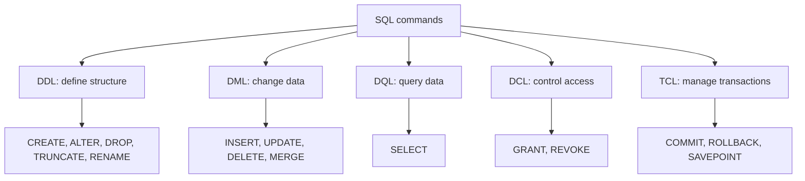

# Advanced SQL — Interview Question Bank

*(This file covers the conceptual side: joins, window functions, CTEs, optimization, indexing, execution plans, stored procedures, and schema design.)*

> Format: Question · Answer · Follow-ups · Difficulty

---

### Q1: Explain the different join types and when you'd use each.

**Moved:** this question was asked in real interviews, so its answer now lives in [`real-world-asked/sql.md`](../real-world-asked/sql.md).

---

### Q2: What's the difference between `WHERE` and `HAVING`, and why can't you filter on an aggregate in `WHERE`?

**Answer:**
`WHERE` filters individual rows **before** grouping; `HAVING` filters **groups**, evaluated after `GROUP BY`/aggregation. Aggregates like `SUM()`/`COUNT()` don't exist yet at the row level `WHERE` operates on — they only exist once rows have been grouped, so referencing them requires `HAVING`.

**Follow-ups:**
- Can `HAVING` be used without `GROUP BY`?
- Which runs first, `WHERE` or `GROUP BY`?

**Difficulty:** Easy

---

### Q3: Explain window functions and how they differ from `GROUP BY`.

**Answer:**
`GROUP BY` collapses rows into one row per group — you lose row-level detail. Window functions (`OVER (PARTITION BY ... ORDER BY ...)`) compute a value **per row** using a "window" of related rows, without collapsing anything — so you keep every original row plus an added computed column (rank, running total, previous value, etc.).
```sql
SELECT customer_id, order_date, amount,
  SUM(amount) OVER (PARTITION BY customer_id ORDER BY order_date) AS running_total,
  LAG(amount) OVER (PARTITION BY customer_id ORDER BY order_date) AS prev_amount
FROM orders;
```

**Follow-ups:**
- Can you use a window function in `WHERE`?
- What's `QUALIFY`?

**Difficulty:** Medium

---

### Q4: What's the difference between `RANK()`, `DENSE_RANK()`, `ROW_NUMBER()`, and `NTILE()`?

**Answer:**
- `ROW_NUMBER()`: unique sequential number, arbitrary tie-break.
- `RANK()`: ties share a rank, next rank skips (1,1,3).
- `DENSE_RANK()`: ties share a rank, no skip (1,1,2).
- `NTILE(n)`: divides rows into `n` roughly equal buckets — useful for percentile-style bucketing (e.g., quartiles of customers by spend).

**Follow-ups:**
- Write a query for the top 3 salaries per department with ties.
- How does `NTILE` handle uneven buckets?

**Difficulty:** Easy

---

### Q5: What is a CTE, and how does it differ from a subquery or a view?

**Answer:**
A **Common Table Expression** (`WITH x AS (...)`) is a named, temporary result set scoped to a single query — improves readability by breaking complex logic into named steps, and can be referenced multiple times within that query. Unlike a **view**, it isn't persisted in the database (exists only for that query's execution). Unlike a nested **subquery**, it can be self-referencing (recursive CTEs) and generally reads top-to-bottom rather than inside-out.
```sql
WITH regional_totals AS (
  SELECT region, SUM(amount) AS total FROM orders GROUP BY region
),
top_regions AS (
  SELECT region FROM regional_totals WHERE total > 100000
)
SELECT * FROM orders WHERE region IN (SELECT region FROM top_regions);
```

**Follow-ups:**
- Can a CTE be referenced multiple times?
- Are CTEs always materialized?

**Difficulty:** Easy

---

### Q6: What is a recursive CTE, and give a use case.

**Answer:**
A CTE that references itself, used for traversing hierarchical/graph-like data (org charts, bill-of-materials, category trees) of unknown depth.
```sql
WITH RECURSIVE org_chart AS (
  SELECT employee_id, manager_id, name, 1 AS level
  FROM employees WHERE manager_id IS NULL          -- anchor: top of hierarchy
  UNION ALL
  SELECT e.employee_id, e.manager_id, e.name, oc.level + 1
  FROM employees e
  JOIN org_chart oc ON e.manager_id = oc.employee_id  -- recursive step
)
SELECT * FROM org_chart ORDER BY level;
```

**Follow-ups:**
- How do you stop infinite recursion?
- Write a recursive CTE to walk an employee–manager hierarchy.

**Difficulty:** Medium

---

### Q7: What is a query execution plan, and what would you look for in one to diagnose a slow query?

**Answer:**
An execution plan shows how the database engine intends to (or did) execute a query — the order operations happen in, which access method is used per table (full scan vs index seek/scan), join algorithms chosen (nested loop, hash join, merge join), and estimated vs actual row counts at each step. Red flags to look for: full table scans on large tables where an index should apply, large estimated-vs-actual row count mismatches (stale statistics), expensive sort/spill-to-disk operations, and nested loop joins over very large row sets (usually should be a hash/merge join instead).

**Follow-ups:**
- What's the difference between a seq scan and an index scan?
- What does a nested loop join with high row counts suggest?

**Difficulty:** Hard

---

### Q8: What's the difference between a clustered and non-clustered index?

**Answer:**
- **Clustered index**: determines the actual physical storage order of table rows — a table can have only one (since rows can only be physically sorted one way). Lookups by the clustered key are fastest since the data itself is found directly.
- **Non-clustered index**: a separate structure holding the indexed column(s) plus a pointer back to the actual row — a table can have many. Faster than a full scan for lookups on that column, but requires an extra step ("bookmark lookup") to fetch other columns not in the index.

**Follow-ups:**
- How many clustered indexes can a table have?
- What's a covering index?

**Difficulty:** Medium

---

### Q9: When would adding an index *hurt* performance rather than help?

**Answer:**
Every index speeds up reads on the indexed column(s) but slows down **writes** (`INSERT`/`UPDATE`/`DELETE`), since each index must also be updated. Over-indexing a write-heavy table, indexing low-cardinality columns (e.g., a boolean flag — the index isn't selective enough to be useful), or having many redundant/overlapping indexes all add maintenance cost without a proportional read benefit.

**Follow-ups:**
- How do indexes slow down writes?
- Why might a low-cardinality column not benefit from an index?

**Difficulty:** Medium

---

### Q10: Explain the difference between `UNION` and `UNION ALL`, and why the choice matters for performance.

**Answer:**
Both stack result sets from multiple queries vertically. `UNION` additionally **deduplicates** the combined result (implicit `DISTINCT`), which requires a sort/hash step — more expensive. `UNION ALL` keeps all rows including duplicates, no dedup step — always prefer it when you know there won't be (or don't care about) duplicates, purely for performance.

**Follow-ups:**
- Do column names need to match in a `UNION`?
- How does `UNION` treat NULLs when deduplicating?

**Difficulty:** Easy

---

### Q11: How would you find duplicate rows in a table, and then delete all but one copy of each?

**Moved:** this question was asked in real interviews, so its answer now lives in [`real-world-asked/sql.md`](../real-world-asked/sql.md).

---

### Q12: What is normalization, and what's the tradeoff with denormalization in analytical schemas?

**Answer:**
Normalization organizes data to minimize redundancy (e.g., 3NF — each fact stored once, related via foreign keys) — good for transactional (OLTP) systems where write consistency matters. Denormalization deliberately duplicates data (e.g., a star schema's flattened dimension attributes, or pre-joined wide tables) to avoid expensive joins at query time — standard for analytical (OLAP) workloads where read performance matters more than storage efficiency or write-side consistency.

**Follow-ups:**
- What do 1NF, 2NF and 3NF mean?
- Why do warehouses denormalize?

**Difficulty:** Medium

---

### Q13: What's the difference between a star schema and a snowflake schema?

**Moved:** this question was asked in real interviews, so its answer now lives in [`real-world-asked/data-warehousing.md`](../real-world-asked/data-warehousing.md).

---

### Q14: What are stored procedures, and what are the tradeoffs of using them vs application-layer logic?

**Answer:**
A stored procedure is precompiled, reusable procedural SQL logic saved in the database (variables, control flow, multiple statements) callable via `CALL`/`EXEC`. Pros: keeps logic close to data (avoids round-trips), can encapsulate complex multi-step operations atomically, reusable across applications. Cons: harder to version-control/test/deploy compared to application code, can create tight coupling between business logic and a specific database engine, and can hide complexity that's easier to reason about and scale in application code (especially in analytical/distributed engines like BigQuery/Snowflake, where procedural logic is less idiomatic than in traditional OLTP databases).

**Follow-ups:**
- How do you version-control stored procedures?
- Why do they make testing harder?

**Difficulty:** Medium

---

### Q15: Explain the differences between `INNER JOIN ... ON` and a correlated subquery, and when each is more appropriate.

**Answer:**
A join combines two sets side-by-side based on a condition, returning combined columns from both. A **correlated subquery** re-executes once per outer row, referencing a column from the outer query — often used for existence checks (`EXISTS`) or per-row scalar comparisons.
```sql
-- Correlated subquery: find customers with at least one order over $1000
SELECT * FROM customers c
WHERE EXISTS (SELECT 1 FROM orders o WHERE o.customer_id = c.customer_id AND o.amount > 1000);
```
Modern query optimizers often rewrite correlated subqueries into semi-joins internally, so performance can be comparable — but a join is usually more natural when you need columns from *both* tables in the result, while `EXISTS`/`IN` subqueries are clearer for pure filtering.

**Follow-ups:**
- When does the optimizer rewrite a correlated subquery as a join?
- How does `EXISTS` compare with `IN`?

**Difficulty:** Medium

---

### Q16: What is the N+1 query problem, and how do you avoid it in a data pipeline?

**Answer:**
Running one query to get a list of items, then a separate query *per item* to fetch related data (N additional queries) — extremely slow at scale due to per-query round-trip overhead. Fix by batching: a single query with a `JOIN` or `WHERE id IN (...)` covering all needed IDs at once, instead of looping and querying one at a time.

**Follow-ups:**
- How would you spot N+1 queries?
- How does batching help?

**Difficulty:** Medium

---

### Q17: How would you page through a very large result set efficiently (beyond simple `LIMIT`/`OFFSET`)?

**Answer:**
`OFFSET` gets progressively slower on large offsets because the database still has to scan and discard all skipped rows. **Keyset (seek) pagination** avoids this by filtering on the last-seen key instead:
```sql
-- Instead of: LIMIT 20 OFFSET 100000  (slow)
SELECT * FROM orders
WHERE order_id > :last_seen_order_id
ORDER BY order_id
LIMIT 20;
```

**BigQuery version:** named query parameters use `@`, set in the console's query settings, with `bq query --parameter`, or through the client library.
```sql
SELECT *
FROM mydataset.orders
WHERE order_id > @last_seen_order_id
ORDER BY order_id
LIMIT 20;
```

**Follow-ups:**
- How does keyset (seek) pagination work?
- Why does `OFFSET` get slower on later pages?

**Difficulty:** Hard

---

### Q18: What's the difference between `COALESCE`, `IFNULL`/`ISNULL`, and `NULLIF`?

**Answer:**
- `COALESCE(a, b, c, ...)`: returns the first non-NULL value among any number of arguments — standard SQL, most portable.
- `IFNULL`/`ISNULL`: engine-specific two-argument shorthand for the same idea (`IFNULL(a, b)` ≈ `COALESCE(a, b)`).
- `NULLIF(a, b)`: returns NULL if `a = b`, otherwise returns `a` — useful for avoiding divide-by-zero (`NULLIF(denominator, 0)`).

**Follow-ups:**
- How does `COALESCE` handle multiple arguments?
- Give a use case for `NULLIF` to avoid division by zero.

**Difficulty:** Easy

---

### Q19: How would you design a schema to efficiently support "as of" / point-in-time historical queries (e.g., "what was this customer's tier on March 1st")?

**Answer:**
Use an **SCD Type 2** pattern: store each version of a changing record as a separate row with `effective_start_date`/`effective_end_date` (or `valid_from`/`valid_to`) columns, rather than overwriting in place.
```sql
SELECT * FROM customer_tier_history
WHERE customer_id = 123
  AND '2024-03-01' BETWEEN effective_start_date AND COALESCE(effective_end_date, '9999-12-31');
```

**Follow-ups:**
- How does SCD Type 2 support this?
- Write the as-of query using `valid_from` and `valid_to`.

**Difficulty:** Hard

---

### Q20: What are query statistics/table statistics, and why do stale statistics cause bad query plans?

**Answer:**
The optimizer relies on statistics (row counts, value distribution/histograms, cardinality estimates) to decide the cheapest execution plan (e.g., which join algorithm, which table to scan first). If statistics are stale (e.g., after a huge bulk load without a refresh), the optimizer's cost estimates are wrong, and it can pick a badly suited plan — e.g., a nested loop join expecting a small table that's actually now huge. Most databases auto-update statistics periodically, but explicit commands exist (`ANALYZE`/`UPDATE STATISTICS`) to force a refresh after major data changes.

**Follow-ups:**
- How do you update statistics?
- What symptoms point to stale statistics?

**Difficulty:** Hard

---

### Q21: What are the categories of SQL commands?

**Answer:**


Points interviewers like: `TRUNCATE` is DDL (it removes all rows quickly, usually can't be filtered, and in many databases can't be rolled back), whereas `DELETE` is DML (row-by-row, filterable, transactional). In BigQuery, access is granted through IAM, although `GRANT` / `REVOKE` statements exist for datasets, tables and views; multi-statement transactions use `BEGIN TRANSACTION ... COMMIT`.

**Follow-ups:**
- What's the difference between `DELETE`, `TRUNCATE` and `DROP`?
- Is `SELECT ... INTO` / `CREATE TABLE AS SELECT` DDL or DML?

**Difficulty:** Easy

---

### Q22: What's the difference between `GROUP BY` and `PARTITION BY`?

**Answer:**
- **`GROUP BY`** collapses rows: you get **one row per group**, and can only select grouped columns and aggregates.
- **`PARTITION BY`** (inside `OVER (...)`) computes a window function **per group while keeping every row**.

```sql
-- One row per department
SELECT department, AVG(salary) AS avg_salary
FROM employees
GROUP BY department;

-- Every employee, with their department's average alongside
SELECT name, department, salary,
       AVG(salary) OVER (PARTITION BY department) AS dept_avg_salary
FROM employees;
```

Use `PARTITION BY` when you need row-level detail plus a group metric, e.g. "employees earning above their department average" or "rank within department".

**Follow-ups:**
- How would you return only employees above their department's average?
- Can you use `GROUP BY` and a window function in the same query?

**Difficulty:** Easy

---

### Q23: How do you compare two tables and find missing or different records?

**Moved:** this question was asked in real interviews, so its answer now lives in [`real-world-asked/sql.md`](../real-world-asked/sql.md).

---

### Q24: How do you implement a Slowly Changing Dimension Type 2 load in SQL?

**Moved:** this question was asked in real interviews, so its answer now lives in [`real-world-asked/sql.md`](../real-world-asked/sql.md).

---

### Q25: How do you filter for the last 7 days and for the previous calendar month?

**Answer:**
Use half-open ranges (`>=` start and `<` end) on the raw date column, so partition pruning and indexes still work:

```sql
-- Last 7 days (including today)
SELECT * FROM orders
WHERE order_date >= CURRENT_DATE - INTERVAL 7 DAY;

-- Previous calendar month
SELECT * FROM orders
WHERE order_date >= date_trunc('month', CURRENT_DATE - INTERVAL 1 MONTH)
  AND order_date <  date_trunc('month', CURRENT_DATE);
```

**BigQuery version:**
```sql
SELECT * FROM `mydataset.orders`
WHERE order_date >= DATE_SUB(CURRENT_DATE(), INTERVAL 7 DAY);

SELECT * FROM `mydataset.orders`
WHERE order_date >= DATE_TRUNC(DATE_SUB(CURRENT_DATE(), INTERVAL 1 MONTH), MONTH)
  AND order_date <  DATE_TRUNC(CURRENT_DATE(), MONTH);
```

Avoid wrapping the column in a function (`EXTRACT(MONTH FROM order_date) = ...`): that blocks pruning and breaks at year boundaries. For `TIMESTAMP` columns, be explicit about the time zone.

**Follow-ups:**
- Should "last 7 days" include today? How would you make that explicit?
- How would you compute month-to-date versus the same period last month?

**Difficulty:** Easy

---

### Q26: What is a cursor, and why are cursors discouraged in data warehouses?

**Answer:**
A cursor lets procedural SQL (T-SQL, PL/pgSQL, Teradata or Oracle procedures) iterate over a result set **row by row**: declare, open, fetch in a loop, close.

They're slow at scale because every row is a separate operation with no set-based optimization or parallelism. Warehouses such as BigQuery are designed for **set-based** SQL, and BigQuery scripting has no cursors (only `FOR ... IN (query)` loops, which are best kept to small control tables). When migrating cursor logic, rewrite it as set operations: `MERGE`, window functions, or `UPDATE ... FROM` joins.

**Follow-ups:**
- How would you rewrite a cursor that computes a running balance per account?
- When is row-by-row processing actually justified?

**Difficulty:** Medium
