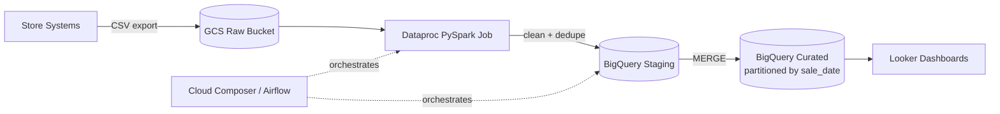

# Architecture: Daily Sales Batch Pipeline

## Components
| Layer | Service | Notes |
|---|---|---|
| Landing | GCS | Raw files partitioned by `dt=YYYY-MM-DD` |
| Processing | Dataproc (PySpark) | Schema validation, dedupe, type casting |
| Warehouse | BigQuery | Partitioned by `sale_date`, clustered by `store_id` |
| Orchestration | Cloud Composer | Daily DAG with GCS sensor and retries |
| Serving | Looker | Sales KPIs by store, region, product |

## Key Design Decisions
- **MERGE into curated** handles late-arriving and corrected files idempotently.
- **Partitioning + clustering** keeps BigQuery scan costs low.
- **Ephemeral Dataproc clusters** reduce cost compared with long-running clusters.
