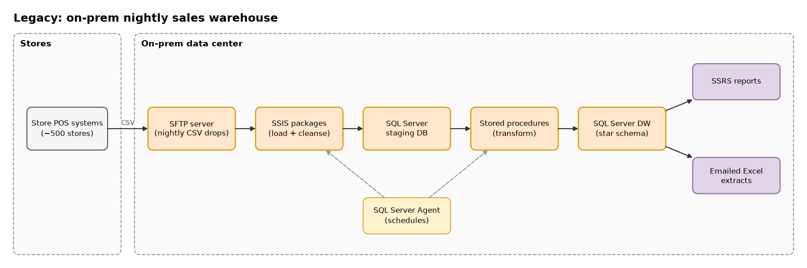

# Legacy Architecture

*Editable source: [diagrams/legacy-architecture.drawio](diagrams/legacy-architecture.drawio)*

## Components

| Layer | Component | Role |
|---|---|---|
| Source | Store POS systems | Export one CSV per store per day after closing |
| Landing | SFTP server | Receives nightly file drops; files are deleted after 14 days |
| Ingestion | SSIS packages | Load the CSVs, apply basic cleansing, write to staging |
| Staging | SQL Server staging DB | Truncated and reloaded every night |
| Transformation | Stored procedures | Build fact and dimension tables (business logic lives here) |
| Warehouse | SQL Server DW | Star schema: `fact_sales`, `dim_store`, `dim_product`, `dim_date` |
| Scheduling | SQL Server Agent | Time-based jobs, with no dependency awareness between steps |
| Consumption | SSRS reports, emailed Excel extracts | Fixed daily reports, plus ad-hoc extracts on request |

## Daily Flow

1. Stores upload CSVs to SFTP between 11 PM and 2 AM.
2. At 1 AM, SQL Server Agent starts the SSIS load, even if some stores haven't uploaded yet.
3. Stored procedures rebuild the warehouse tables. A full `fact_sales` rebuild for the current month takes 3–4 hours.
4. SSRS subscriptions send reports at 6 AM, sometimes before the load has finished.

## Pain Points

- **Fixed time slots instead of dependencies:** if a step runs late, the next step starts on stale data anyway.
- **Not idempotent:** a partial failure followed by a rerun can insert duplicate rows, which have to be cleaned up by hand.
- **Late files are lost:** a store that uploads after 1 AM is missed until someone reloads it manually.
- **Scaling is limited:** compute and storage are tied to one server, and adding capacity means a hardware purchase.
- **Hidden logic:** business rules are spread across SSIS expressions and roughly 40 stored procedures, with little documentation.
- **No replay:** raw files are kept for only 14 days, so a bug fixed later can't be backfilled from source.
