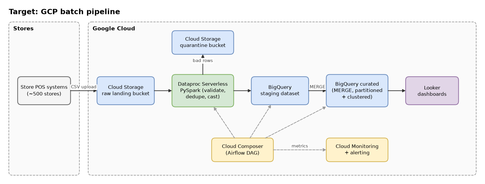

# Target Architecture

*Editable source: [diagrams/target-architecture.drawio](diagrams/target-architecture.drawio)*

## Components

| Layer | Service | Notes |
|---|---|---|
| Landing | Cloud Storage raw bucket | Files stored as `dt=YYYY-MM-DD/store_id=NNN/`; kept for 3 years, moved to Coldline after 90 days |
| Processing | Dataproc Serverless (PySpark) | Schema validation, dedupe on `(store_id, txn_id, line_no)`, type casting; no cluster to manage |
| Quarantine | Cloud Storage quarantine bucket | Rejected rows with a reason code, for review and replay |
| Staging | BigQuery `sales_staging` | One table per run date, overwritten on rerun |
| Curated | BigQuery `sales_curated` | `fact_sales` partitioned by `sale_date`, clustered by `store_id, product_id`; dimensions as SCD Type 2 |
| Orchestration | Cloud Composer (Airflow) | One daily DAG with a GCS sensor, retries, SLA alert at 5:30 AM, backfill via `catchup` |
| Serving | Looker | Semantic model on top of curated tables, replacing SSRS reports and Excel extracts |
| Observability | Cloud Monitoring | Alerts on DAG failure, SLA miss, quarantine rate above 0.5%, and row-count anomalies |

## Daily Flow

1. Stores upload CSVs straight to the raw bucket, using signed URLs issued by a small upload service.
2. The Composer DAG waits until either 95% of stores have uploaded or 3:30 AM, whichever comes first.
3. Dataproc Serverless processes the day's files and writes clean Parquet to BigQuery staging. Bad rows go to quarantine.
4. A `MERGE` into `fact_sales` updates only the affected `sale_date` partitions, so late files simply trigger a rerun for that date.
5. Data quality checks (row counts against file manifests, totals, null keys) gate a final "data ready" marker that Looker dashboards respect.

## Key Design Decisions

- **Idempotent by partition:** every run rebuilds staging for its run date and `MERGE`s by business key, so reruns and backfills are safe.
- **Raw data is immutable and kept:** any bug fix can be replayed from source for any date in the last 3 years.
- **Event-driven plus a deadline:** starting the run on file arrival, with a hard cutoff, balances completeness against the 6 AM SLA.
- **Partitioning and clustering:** the typical dashboard query (last 30 days, a few stores) scans less than 1% of the table.
- **Serverless compute:** no idle cluster cost, and capacity scales automatically for month-end and holiday peaks.
