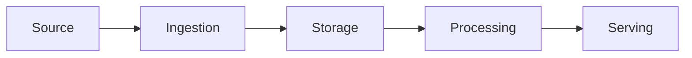

# Design Doc: <System Name>

## 1. Problem Statement
<What problem are we solving, and for whom?>

## 2. Requirements
### Functional
- 
### Non-Functional
- **Scale:** <data volume, events/sec, growth>
- **Latency / Freshness:** <batch SLA, real-time?>
- **Availability / Reliability:**
- **Cost constraints:**

## 3. High-Level Architecture

## 4. Component Design
| Component | Technology | Why |
|---|---|---|
| Ingestion | | |
| Storage | | |
| Processing | | |
| Orchestration | | |
| Serving | | |

## 5. Data Model
<Key tables/entities, partitioning, clustering>

## 6. Data Quality & Monitoring
<Validation checks, alerting, lineage, observability>

## 7. Security & Governance
<IAM, encryption, PII handling, access control>

## 8. Trade-offs & Alternatives
<What else was considered, and why it wasn't chosen>

## 9. Failure Scenarios
<Late data, duplicates, schema drift, backfills, retries>

## 10. Follow-up Questions an Interviewer May Ask
- 
